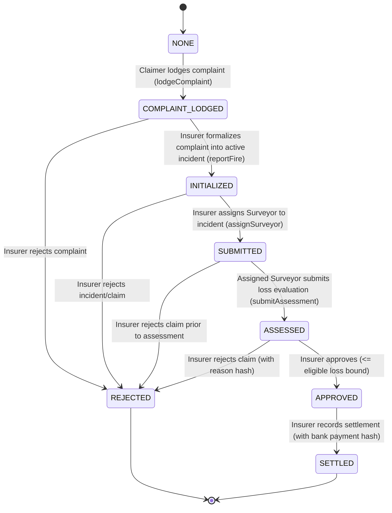

# FireChain — Decentralized Fire Insurance Claims Workflow Platform

[](https://soliditylang.org/)
[](https://hardhat.org/)
[](https://openzeppelin.com/contracts/)
[](https://docs.ethers.org/v6/)
[](https://react.dev/)
[](https://vitejs.dev/)
[](https://tailwindcss.com/)
[](LICENSE)

**FireChain** is an enterprise-grade decentralized insurance protocol and DApp engineered on Ethereum. It provides a transparent, verifiable, and tamper-resistant workflow for fire insurance policy underwriting, citizen complaint lodging, civic fire incident verification, independent loss assessment, and bank settlement attestations.

The platform employs an **off-chain document storage with on-chain cryptographic fingerprinting ("Hash-on-Chain")** model. Sensitive original documents (policy contracts, evidence photos, fire department investigation reports, and surveyor loss assessments) remain securely stored in local infrastructure, while immutable 32-byte SHA-256 / Keccak-256 hashes, timestamps, and multi-party attestations are recorded on the blockchain.

The platform includes a **complete CLI automation suite** and a **modern, role-based Web3 React DApp** featuring real MetaMask authentication, strict on-chain role enforcement, real-time dynamic notification queues, and an integrated blockchain policy ledger visualizer.

---

## Table of Contents

- [Quick Start: Full Stack in 3 Commands](#quick-start-full-stack-in-3-commands)
- [Key Architecture & Design Principles](#key-architecture--design-principles)
- [Workflow & State Machine Diagrams](#workflow--state-machine-diagrams)
  - [Multi-Party End-to-End Sequence Diagram](#multi-party-end-to-end-sequence-diagram)
  - [Claim Lifecycle State Machine (8 States)](#claim-lifecycle-state-machine-8-states)
- [Stakeholders & 5 On-Chain Roles](#stakeholders--5-on-chain-roles)
- [Interactive Web UI / Role Dashboards](#interactive-web-ui--role-dashboards)
  - [1. Insurer Desk & Dynamic Workflow Queue](#1-insurer-desk--dynamic-workflow-queue)
  - [2. Blockchain Policy Ledger Visualizer](#2-blockchain-policy-ledger-visualizer)
  - [3. Claimer Portal & Simplified Complaint Flow](#3-claimer-portal--simplified-complaint-flow)
  - [4. Fire Officer Civic Oracle & Offline Auto-Hashing](#4-fire-officer-civic-oracle--offline-auto-hashing)
  - [5. Surveyor Assessment with Mathematical Guardrails](#5-surveyor-assessment-with-mathematical-guardrails)
  - [6. Admin Governance & RBAC Portal](#6-admin-governance--rbac-portal)
  - [7. TransactionReceipt Block Finality Visualizer](#7-transactionreceipt-block-finality-visualizer)
- [Mathematical Loss & Claim Calculation](#mathematical-loss--claim-calculation)
- [Repository Directory Structure](#repository-directory-structure)
- [Prerequisites & Environment Setup](#prerequisites--environment-setup)
- [Step-by-Step CLI Execution Guide](#step-by-step-cli-execution-guide)
  - [1. Environment & Build Checks](#1-environment--build-checks)
  - [2. Start Local Node & Deploy](#2-start-local-node--deploy)
  - [3. End-to-End Claims Workflow](#3-end-to-end-claims-workflow)
  - [4. Query & Verification Commands](#4-query--verification-commands)
- [Security, Privacy & Prototype Limitations](#security-privacy--prototype-limitations)
- [License](#license)

---

## Quick Start: Full Stack in 3 Commands

To run the local blockchain and the interactive Web DApp dashboard simultaneously:

#### Terminal 1 — Start Local Ethereum Node:
```powershell
npx hardhat node --network hardhatMainnet
```

#### Terminal 2 — Deploy Contract & Seed Stakeholders:
```powershell
npm run deploy:local
npm run register:stakeholders
```

#### Terminal 3 — Launch the Frontend DApp:
```powershell
npm run frontend:dev
```
Open **`http://localhost:5173`** in your browser to access the FireChain dashboard.

---

## Key Architecture & Design Principles

1. **Hash-on-Chain Privacy**: Public blockchains are transparent. To protect policyholders and prevent GDPR/privacy violations, no personally identifiable information (PII), names, phone numbers, or confidential documents are written to the contract. Only cryptographic hashes (`bytes32`) serve as tamper-evident proofs.
2. **Single-Active-Claim Guardrail**: The smart contract prevents duplicate claims against a single policy by strictly validating `policyToActiveClaimId[policyId] == 0` during `lodgeComplaint`.
3. **Simplified Citizen Complaint Lodging**: Claimants holding `CLAIMER_ROLE` initiate claims directly on-chain by lodging a preliminary complaint (`lodgeComplaint(policyId)`) without needing to perform complex client-side cryptographic hashing.
4. **Real-World Oracles & Separation of Duties**: Real-world authorized actors (Civic Fire Officers and Independent Surveyors) act as attestors / oracles to independently authenticate incidents and quantify physical loss before any claim approval.
5. **Strict Integer Loss Bounds**: Integer arithmetic denominated in **INR paise** (₹1 = 100 paise) prevents floating-point inaccuracies. Total loss and salvage guardrails (`salvageValue <= totalLoss`) are strictly enforced both client-side and on-chain.
6. **No Direct Token/Fiat Custody**: Settlements are recorded as insurer attestations linked to off-chain bank payment transaction hashes (NEFT / RTGS / UTR). The contract does not transfer ETH or fiat.
7. **Real Web3 Authentication**: No simulated Web2 credentials or mock personas. Users authenticate directly via MetaMask, and dashboard access is strictly governed by the on-chain `hasRole()` smart contract response.

---

## Workflow & State Machine Diagrams

### Multi-Party End-to-End Sequence Diagram

```mermaid
sequenceDiagram
    autonumber
    actor Admin as Admin (Deployer / Miner)
    actor Claimer as Policyholder / Claimer
    actor Insurer as Insurer (Claims Dept)
    actor Officer as Fire Department Officer
    actor Surveyor as Independent Surveyor
    participant Contract as FireInsurance Smart Contract

    Note over Admin,Contract: Phase 0: Initialization & RBAC
    Admin->>Contract: deployContract("FireInsurance")
    Admin->>Contract: registerStakeholder(Insurer, INSURER_ROLE)
    Admin->>Contract: registerStakeholder(Officer, FIRE_OFFICER_ROLE)
    Admin->>Contract: registerStakeholder(Surveyor, SURVEYOR_ROLE)
    Admin->>Contract: registerStakeholder(Claimer, CLAIMER_ROLE)

    Note over Insurer,Contract: Phase 1: Policy Issuance
    Insurer->>Contract: registerPolicy(PolicyInput with doc/terms hashes)
    Insurer->>Contract: verifyPolicy(policyId)

    Note over Claimer,Contract: Phase 2: Fire Incident Complaint Lodging
    Claimer->>Contract: lodgeComplaint(policyId)
    Note right of Contract: Duplicate claim check passed; Status: COMPLAINT_LODGED

    Note over Insurer,Officer: Phase 3: Incident Formalization & Civic Certification
    Insurer->>Contract: reportFire(policyId, incidentDate, incidentRefHash)
    Note right of Contract: Status: INITIALIZED
    Officer->>Contract: verifyIncident(incidentId, fireReportHash)
    Note right of Contract: Incident certified by Civic Oracle

    Note over Insurer,Surveyor: Phase 4: Loss Survey & Assessment
    Insurer->>Contract: assignSurveyor(incidentId, surveyorAddress)
    Note right of Contract: Status: SUBMITTED
    Surveyor->>Contract: submitAssessment(claimId, buildingLoss, contentsLoss, machineryLoss, salvageValue, reportHash)
    Note right of Contract: Mathematical bounds verified; Status: ASSESSED

    Note over Insurer,Contract: Phase 5: Claim Decision & Settlement Attestation
    alt Approved Claim
        Insurer->>Contract: approveClaim(claimId, approvedAmount <= eligibleAmount)
        Note right of Contract: Status: APPROVED
        Note over Insurer: Off-chain bank disbursement (NEFT/RTGS)
        Insurer->>Contract: recordSettlement(claimId, settledAmount, paymentRefHash)
        Note right of Contract: Status: SETTLED
    else Rejected Claim
        Insurer->>Contract: rejectClaim(claimId, reasonHash)
        Note right of Contract: Status: REJECTED
    end
```

### Claim Lifecycle State Machine (8 States)



---

## Stakeholders & 5 On-Chain Roles

FireChain defines 5 distinct on-chain roles governed by OpenZeppelin's `AccessControl`:

| Role Constant | Hash Identifier (`keccak256`) | Responsibilities & Access Permissions |
| :--- | :--- | :--- |
| **`DEFAULT_ADMIN_ROLE`** | `0x0000...0000` | Deploys contracts, registers/revokes stakeholder roles (`registerStakeholder`), audits system ledgers. |
| **`INSURER_ROLE`** | `keccak256("INSURER_ROLE")` | Underwrites policies, verifies policy coverage, formalizes citizen complaints (`reportFire`), assigns surveyors, approves/rejects claims, records bank settlements. |
| **`FIRE_OFFICER_ROLE`** | `keccak256("FIRE_OFFICER_ROLE")` | Civic authority / oracle. Inspects incident reports, validates emergency dispatches, and commits official fire department report hashes on-chain (`verifyIncident`). |
| **`SURVEYOR_ROLE`** | `keccak256("SURVEYOR_ROLE")` | Licensed loss assessor. Submits itemized loss breakdowns (building, contents, machinery, salvage) and assessment report hashes (`submitAssessment`). |
| **`CLAIMER_ROLE`** | `keccak256("CLAIMER_ROLE")` | Policyholder / claimant. Lodges preliminary fire incident complaints (`lodgeComplaint`) and tracks claim status. |

---

## Interactive Web UI / Role Dashboards

The DApp frontend ([`frontend/`](frontend)) provides customized, role-protected dashboards for each participant in the ecosystem:

### 1. Insurer Desk & Dynamic Workflow Queue
- **Streamlined Dashboard Layout**: Legacy horizontal navigation tabs have been replaced with a dynamic, unified workflow queue.
- **Permanent "Issue Policy" Panel**: Anchored at the top with collapsible toggling, cryptographic file hashing for policy terms/documents, and quick policy verification.
- **Dynamic Recency Sorting**: Automatically hoists the most recently updated claim/incident to the absolute top of the feed based on on-chain activity timestamps.
- **Real-Time Search & Filter**: Filter claims instantly by `Claim ID`, `Policy ID`, or `Incident Reference Hash`.
- **6-State Action Menus & Modals**:
  - `COMPLAINT_LODGED` &rarr; Action menu: **"Formalize Incident"** (opens modal) or **"Discard"** (locally hides).
  - `INITIALIZED` (unverified) &rarr; Status: **"Pending work of Fire Officer"** (action disabled).
  - `INITIALIZED` (verified) &rarr; Action menu: **"Assign Surveyor"** (opens modal) or **"Discard"**.
  - `SUBMITTED` &rarr; Status: **"Pending work of Surveyor"** (action disabled).
  - `ASSESSED` &rarr; Action menu: **"Approve Claim"** (opens modal) or **"Discard"**.
  - `APPROVED` &rarr; Action menu: **"Record Settlement"** (opens modal) or **"Discard"**.

### 2. Blockchain Policy Ledger Visualizer
- **Component**: [`PolicyLedger.tsx`](frontend/src/components/PolicyLedger.tsx) integrated directly into the Insurer Dashboard.
- **Live Node Synchronization**: "Sync from Blockchain" button querying `getTotalPolicies()`, `getPolicy(i)`, and `policyToActiveClaimId(i)` in real time.
- **Filterable Statuses**: Filter by `All`, `Active`, `Claimed`, or `Expired`.
- **Color-Coded Status Badges**:
  - <span style="color:#10b981">**Active (Green)**</span>: Policy valid with no active claims.
  - <span style="color:#f59e0b">**Claimed (Orange)**</span>: Active claim ID exists on-chain.
  - <span style="color:#ef4444">**Expired (Red)**</span>: Policy end timestamp is in the past.
- **Data Table**: Displays `Policy ID`, truncated `Policyholder Ref` hash, formatted `Sum Insured` in INR, `Start Date`, `End Date`, and `Status`.

### 3. Claimer Portal & Simplified Complaint Flow
- **Single-Input Filing**: Enter the `policyId` to lodge a claim directly via `contract.lodgeComplaint(policyId)`.
- **Duplicate Claim Protection**: Built-in verification halts submissions if a policy already has an active claim.
- **Live Status Feed**: Read-only tracking for the claimant's complaints through all 8 lifecycle states.

### 4. Fire Officer Civic Oracle & Offline Auto-Hashing
- **Conditional Form Display**: Form remains hidden by default, revealing only when a pending incident is selected from the unverified queue.
- **Zero-Transmission Offline File Hashing**: In-browser `crypto.subtle` SHA-256 calculation converts raw incident report files into 32-byte digests. The original file never leaves the user's machine.

### 5. Surveyor Assessment with Mathematical Guardrails
- **Conditional Form**: Assessment submission opens only when an assigned claim is selected.
- **Client-Side Guardrails**: Evaluates $\text{salvageValue} \le (\text{buildingLoss} + \text{contentsLoss} + \text{machineryLoss})$ in real time, preventing transaction reverts before they hit the blockchain.
- **Integrated File Hasher**: Computes technical appraisal document hashes for tamper-evident on-chain attestation.

### 6. Admin Governance & RBAC Portal
- **Contract Metrics**: Real-time read of `getTotalPolicies`, `getTotalIncidents`, `getTotalClaims`, and `getTotalAssessments`.
- **Stakeholder Management**: Role registration (`registerStakeholder`) and revocation (`revokeStakeholder`) across all roles.

### 7. TransactionReceipt Block Finality Visualizer
- **Component**: [`TransactionReceipt.tsx`](frontend/src/components/TransactionReceipt.tsx).
- Automatically displays upon mining of any state-modifying transaction across any dashboard.
- Surfaces `transactionHash`, `blockNumber`, and `gasUsed` for complete verification.

---

## Mathematical Loss & Claim Calculation

When the surveyor submits an assessment, the smart contract enforces strict math guardrails before writing to storage:

$$\text{totalLoss} = \text{buildingLoss} + \text{contentsLoss} + \text{machineryLoss}$$

$$\text{grossLoss} = \text{totalLoss} - \text{salvageValue} \quad (\text{Contract enforces: } \text{salvageValue} \le \text{totalLoss})$$

$$\text{eligibleAmount} = \min\Big(\max(\text{grossLoss} - \text{deductible}, 0), \; \text{sumInsured}\Big)$$

- **Strict Salvage Guard**: `require(salvageValue <= totalLoss, "Salvage exceeds total loss");` prevents underflow.
- **Duplicate Claim Guard**: `require(policyToActiveClaimId[policyId] == 0, "An active claim already exists for this policy");`.
- **Approval Guardrail**: The insurer can only approve an amount satisfying $0 < \text{approvedAmount} \le \text{eligibleAmount}$.
- **Settlement Guardrail**: The recorded settlement amount must strictly equal $\text{approvedAmount}$.

---

## Repository Directory Structure

```text
FireChain/
├── contracts/
│   └── FireInsurance.sol          # Core Solidity smart contract (AccessControl, 8 states)
├── frontend/                      # Web UI / DApp Dashboard
│   ├── index.html                 # Single page application entry
│   ├── package.json               # Frontend dependencies (React, Vite, Ethers v6, Tailwind)
│   ├── vite.config.ts             # Vite bundler configuration
│   ├── tailwind.config.js         # Custom theme & styling configuration
│   └── src/
│       ├── App.tsx                # Protected role-based routing & Web3 authentication shell
│       ├── main.tsx               # React root render
│       ├── config/                # Contract ABI, constants, status mappings
│       ├── context/               # Web3Context with MetaMask connection & on-chain hasRole() checks
│       ├── components/            # Shared components:
│       │   ├── Navbar.tsx         # Header navigation (clean brand logo & wallet stats)
│       │   ├── PolicyLedger.tsx   # Blockchain policy ledger visualizer & status filter
│       │   ├── TransactionReceipt.tsx # Cryptographic EVM block mining proof component
│       │   ├── FileHasher.tsx     # Client-side offline SHA-256 file hashing utility
│       │   ├── StatCard.tsx       # Reusable analytics card
│       │   └── Badge.tsx          # Status indicators
│       ├── pages/                 # Role-based dashboards:
│       │   ├── AdminDashboard.tsx       # Stakeholder RBAC & global protocol metrics
│       │   ├── InsurerDashboard.tsx     # Dynamic lifecycle queue, policy issuance & modals
│       │   ├── FireOfficerDashboard.tsx # Civic oracle incident certification
│       │   ├── SurveyorDashboard.tsx    # Loss appraisal with client-side math guardrails
│       │   └── ClaimerDashboard.tsx     # Citizen complaint filing & status tracking
│       └── utils/                 # Crypto hashing & currency/date formatters
├── scripts/                       # CLI TypeScript workflow automation scripts
│   ├── deploy.ts                  # Hardhat deployment script
│   ├── register-stakeholders.ts   # Assigns RBAC stakeholder roles
│   ├── register-policy.ts         # Registers insurance policy
│   ├── verify-policy.ts           # Verifies policy underwriting
│   ├── report-fire.ts             # Reports fire incident
│   ├── verify-incident.ts         # Fire officer incident certification
│   ├── assign-surveyor.ts         # Assigns independent surveyor
│   ├── submit-assessment.ts       # Submits itemized loss assessment
│   ├── approve-claim.ts           # Insurer claim approval
│   ├── record-settlement.ts       # Insurer bank disbursement attestation
│   ├── reject-claim.ts            # Claim rejection with reason hash
│   ├── cancel-policy.ts           # Policy cancellation
│   ├── get-policy.ts              # Queries single policy record
│   ├── get-incident.ts            # Queries single incident record
│   ├── get-claim.ts               # Queries single claim record
│   ├── list-record.ts             # Comprehensive ledger audit summary
│   ├── test-roles.ts              # RBAC boundary verification
│   └── hash-document.ts           # CLI document SHA-256 calculator
├── test/
│   └── FireInsurance.test.ts      # Automated unit & integration tests
├── hardhat.config.ts              # Hardhat configuration (local node & Sepolia)
├── package.json                   # Root dependencies & CLI npm scripts
└── README.md                      # Project documentation
```

---

## Prerequisites & Environment Setup

### System Requirements
- **Node.js**: v20 or higher
- **npm**: v10.0.0 or higher
- **MetaMask Extension**: Installed in browser for Web3 DApp interaction
- **OS**: Windows, macOS, or Linux

### Installation

Clone the repository and install all dependencies:

```powershell
npm install
cd frontend && npm install && cd ..
```

Configure your local environment:
```powershell
cp .env.example .env
```

---

## Step-by-Step CLI Execution Guide

### 1. Environment & Build Checks

Compile the Solidity smart contracts:
```powershell
npm run compile
```

Run the automated test suite:
```powershell
npm test
```

### 2. Start Local Node & Deploy

```powershell
# Terminal 1: Start local node
npx hardhat node --network hardhatMainnet

# Terminal 2: Deploy & Seed Stakeholders
npm run deploy:local
npm run register:stakeholders
```

### 3. End-to-End Claims Workflow

1. **Register Insurance Policy**: `npm run register:policy`
2. **Verify Policy**: `npm run verify:policy`
3. **Report Fire Incident**: `npm run report:fire`
4. **Fire Department Verification**: `npm run verify:incident`
5. **Assign Independent Surveyor**: `npm run assign:surveyor`
6. **Submit Loss Assessment**: `npm run submit:assessment`
7. **Approve Claim**: `npm run approve:claim`
8. **Disburse & Record Bank Settlement**: `npm run record:settlement`
9. **Audit Ledger Summary**: `npm run list:records`

### 4. Query & Verification Commands

```powershell
npm run get:policy -- --id 1
npm run get:incident -- --id 1
npm run get:claim -- --id 1
npm run test:roles
```

---

## Security, Privacy & Prototype Limitations

1. **Academic Scope**: This repository is an academic and architectural prototype. It has not undergone formal security audits and must not be used with real financial assets.
2. **Data Minimization**: Sensitive original documents never reside on-chain. Only cryptographic 32-byte digests and workflow state transitions are committed to the distributed ledger.
3. **Off-Chain Oracles**: Smart contracts cannot independently verify physical world events. The trust model relies on the authenticated identities of civic fire department officials and licensed loss adjusters.
4. **Off-Chain Fiat Settlement**: Real-world claim disbursements occur through banking networks (NEFT/RTGS). The smart contract serves as an immutable audit trail and payment attestation log rather than a payment processor.

---

## License

This project is licensed under the **MIT License** — see the [LICENSE](LICENSE) file for details.
