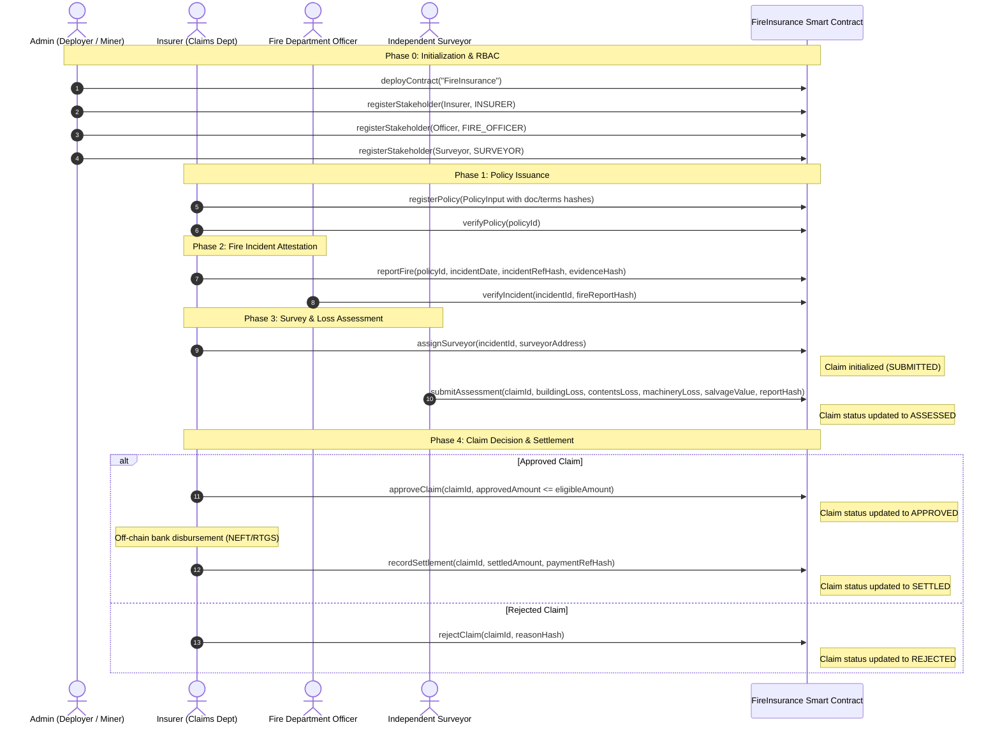
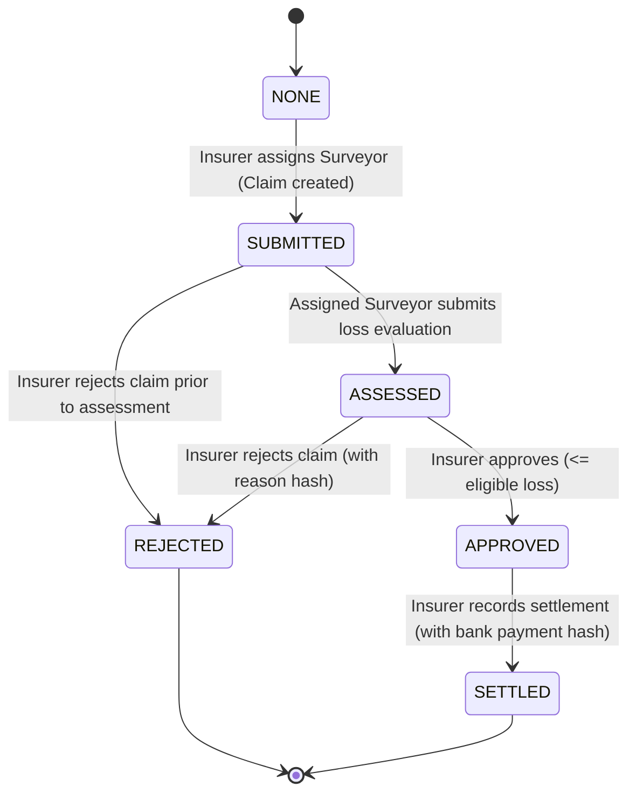

# FireChain — Decentralized Fire Insurance Claims Workflow Prototype

[](https://soliditylang.org/)
[](https://hardhat.org/)
[](https://openzeppelin.com/contracts/)
[](https://docs.ethers.org/v6/)
[](https://react.dev/)
[](https://vitejs.dev/)
[](https://tailwindcss.com/)
[](LICENSE)

**FireChain** is an enterprise-oriented, academic smart contract prototype engineered on Ethereum. It provides a transparent, verifiable, and tamper-resistant workflow for fire insurance policy lifecycle management, incident verification, loss assessment, and claim settlements.

The architecture adopts an **off-chain document storage, on-chain cryptographic fingerprint ("Hash-on-Chain")** model. Sensitive original documents (policy contracts, evidence photos, fire department reports, and surveyor loss assessments) remain securely stored in the insurer's local infrastructure, while immutable 32-byte SHA-256 / Keccak-256 hashes, timestamps, and multi-party attestations are recorded on the blockchain.

The project features both a **full CLI automation script suite** and an **interactive Web UI / DApp dashboard** with role-based portals for Insurers, Civic Fire Officers, Surveyors, and Admins.

---

## Table of Contents

- [Quick Start: Full Stack in 3 Commands](#quick-start-full-stack-in-3-commands)
- [Key Architecture & Design Principles](#key-architecture--design-principles)
- [Workflow & State Machine Diagrams](#workflow--state-machine-diagrams)
  - [Multi-Party End-to-End Sequence Diagram](#multi-party-end-to-end-sequence-diagram)
  - [Claim Lifecycle State Machine](#claim-lifecycle-state-machine)
- [Stakeholders, Roles & Pre-configured Accounts](#stakeholders-roles--pre-configured-accounts)
- [Interactive Web UI / DApp Dashboard](#interactive-web-ui--dapp-dashboard)
- [Mathematical Loss & Claim Calculation](#mathematical-loss--claim-calculation)
- [Repository Directory Structure](#repository-directory-structure)
- [Prerequisites & Environment Setup](#prerequisites--environment-setup)
- [Step-by-Step CLI Execution Guide](#step-by-step-cli-execution-guide)
  - [1. Environment & Build Checks](#1-environment--build-checks)
  - [2. Start Local Node & Deploy](#2-start-local-node--deploy)
  - [3. End-to-End 9-Step Claims Workflow](#3-end-to-end-9-step-claims-workflow)
  - [4. Query & Verification Commands](#4-query--verification-commands)
  - [5. Alternative Paths (Rejection & Cancellation)](#5-alternative-paths-rejection--cancellation)
  - [6. Local Document Hashing Utility](#6-local-document-hashing-utility)
- [Sepolia Testnet Deployment](#sepolia-testnet-deployment)
- [Security, Privacy & Prototype Limitations](#security-privacy--prototype-limitations)

---

## Quick Start: Full Stack in 3 Commands

To run the local blockchain and the interactive Web DApp dashboard simultaneously:

#### Terminal 1 — Start Local Ethereum Node:
```powershell
npx hardhat node --network hardhatMainnet
```

#### Terminal 2 — Deploy Contract & Seed Stakeholders:
```powershell
npm run deploy:local
npm run register:stakeholders
```

#### Terminal 3 — Launch the Frontend DApp:
```powershell
npm run frontend:dev
```
Open **`http://localhost:5173`** in your browser to access the FireChain dashboard.

---

## Key Architecture & Design Principles

1. **Hash-on-Chain Privacy**: Public blockchains are transparent. To protect policyholders and prevent GDPR/privacy violations, no personally identifiable information (PII), names, phone numbers, or confidential documents are written to the contract. Only cryptographic hashes (`bytes32`) serve as tamper-evident proofs.
2. **Real-World Oracles & Separation of Duties**: A blockchain cannot autonomously detect fires. Real-world authorized actors (Civic Fire Officers and Independent Surveyors) act as attestors / oracles to independently authenticate incidents and quantify physical loss before any claim approval.
3. **No Direct Token/Fiat Custody**: Amounts are denominated in integer **INR paise** (₹1 = 100 paise) to eliminate floating-point inaccuracies. Settlements are recorded as insurer attestations linked to off-chain bank payment transaction hashes (e.g., NEFT / RTGS / UTR). The contract does not transfer ETH or fiat.
4. **Historical Continuity on Cancellation**: If a policy is cancelled, `cancelledAt` is timestamped while `verified` remains true. Incidents occurring before cancellation remain historically eligible, while incidents on or after cancellation are rejected.

---

## Workflow & State Machine Diagrams

### Multi-Party End-to-End Sequence Diagram



### Claim Lifecycle State Machine



---

## Stakeholders, Roles & Pre-configured Accounts

The prototype uses the standard Hardhat test mnemonic:
```text
test test test test test test test test test test test junk
```

When running local nodes (`npx hardhat node`), accounts are seeded with 10,000 local test ETH. Roles and permissions are strictly enforced on-chain via OpenZeppelin's `AccessControl`.

| Account Index | Stakeholder / Entity | Role Identifier | Public Address (Checksummed) | Private Key | Responsibilities & Permissions |
| :---: | :--- | :--- | :--- | :--- | :--- |
| **#0** | **Admin & Local Miner** | `DEFAULT_ADMIN_ROLE` | `0xf39Fd6e51aad88F6F4ce6aB8827279cffFb92266` | `0xac0974bec39a17e36ba4a6b4d238ff944bacb478cbed5efcae784d7bf4f2ff80` | Deploys contracts, registers/revokes stakeholder roles, mines blocks as default validator. |
| **#1** | **Insurer** | `INSURER_ROLE` | `0x70997970C51812dc3A010C7d01b50e0d17dc79C8` | `0x59c6995e998f97a5a0044966f0945389dc9e86dae88c7a8412f4603b6b78690d` | Underwrites policies, verifies coverage, reports fire incidents, assigns surveyors, approves/rejects claims, records bank settlements. |
| **#2** | **Fire Department Officer** | `FIRE_OFFICER_ROLE` | `0x3C44CdDdB6a900fa2b585dd299e03d12FA4293BC` | `0x5de4111afa1a4b94908f83103eb1f1706367c2e68ca870fc3fb9a804cdab365a` | Civic authority / oracle. Inspects incident reports, validates emergency dispatches, and commits official fire department report hashes on-chain. |
| **#3** | **Independent Surveyor** | `SURVEYOR_ROLE` | `0x90F79bf6EB2c4f870365E785982E1f101E93b906` | `0x7c852118294e51e653712a81e05800f419141751be58f605c371e15141b007a6` | Licensed loss assessor. Submits itemized loss breakdowns (building, contents, machinery, salvage) and assessment report hashes. |
| **#4** | **Unauthorized User / Claimant** | *None (Unprivileged)* | `0x15d34AAf54267DB7D7c367839AAf71A00a2C6A65` | `0x47e179ec197488593b187f80a00eb0da91f1b9d0b13f8733639f19c30a34926a` | Represents arbitrary external accounts or claimants. Used in negative testing to prove access restrictions. |

---

## Interactive Web UI / DApp Dashboard

The project includes an interactive Web3 dashboard located in [`frontend/`](frontend) designed for stakeholder demonstrations and evaluation:

### Key Features
1. **1-Click Dev Persona Switcher**:
   - Easily switch between **Admin**, **Insurer**, **Fire Officer**, and **Surveyor** directly from the top navigation dropdown.
   - Pre-configured with Hardhat local test wallets for instant evaluation without MetaMask or browser extensions.
   - Also supports **MetaMask / Injected Wallet** connections for Sepolia testnet testing.
2. **Offline Cryptographic Document Hasher**:
   - Drag-and-drop or upload any document (PDF, PNG, JPG).
   - Instant client-side SHA-256 fingerprint generation using native `crypto.subtle`. Documents are never transmitted over the network.
3. **Dedicated Portals**:
   - **Overview Dashboard**: High-level metrics (Policies, Incidents, Claims, Settled amount) and live claims feed.
   - **Policies Desk**: Policy underwriting registration, 1-click verification, historical cancellation, and real-time coverage lookup.
   - **Fire Incidents Desk**: Incident reporting with damage evidence fingerprints, and Civic Fire Officer certification queue.
   - **Claims & Surveying Desk**: Surveyor assignment, interactive itemized loss calculator with live eligible bound enforcement, insurer approval, and bank settlement attestation (UTR).
   - **Admin RBAC Console**: Role auditing and a **"1-Click Seed All Demo Roles"** utility.

### Running the Frontend
```powershell
# From project root:
npm run frontend:dev

# Or inside frontend/:
cd frontend
npm run dev
```

Build for production:
```powershell
npm run frontend:build
```

---

## Mathematical Loss & Claim Calculation

When the surveyor submits an assessment, the smart contract computes bounds using integer math:

$$\text{totalLoss} = \text{buildingLoss} + \text{contentsLoss} + \text{machineryLoss}$$

$$\text{grossLoss} = \text{totalLoss} - \text{salvageValue} \quad (\text{Contract enforces: } \text{salvageValue} \le \text{totalLoss})$$

$$\text{eligibleAmount} = \min\Big(\max(\text{grossLoss} - \text{deductible}, 0), \; \text{sumInsured}\Big)$$

- **Approval Guardrail**: The insurer can only approve an amount satisfying $0 < \text{approvedAmount} \le \text{eligibleAmount}$.
- **Settlement Guardrail**: The recorded settlement amount must strictly equal $\text{approvedAmount}$.

---

## Repository Directory Structure

```text
FireChain/
├── contracts/
│   └── FireInsurance.sol          # Core Solidity smart contract
├── frontend/                      # Web UI / DApp Dashboard
│   ├── index.html                 # Single page application entry
│   ├── package.json               # Frontend dependencies (React, Vite, Ethers, Tailwind)
│   ├── vite.config.ts             # Vite bundler configuration
│   ├── tailwind.config.js         # Custom theme & styling configuration
│   └── src/
│       ├── App.tsx                # App shell, tab switcher & alerts
│       ├── main.tsx               # React root render
│       ├── config/                # ABI definitions & Hardhat personas
│       ├── context/               # Web3Context provider & role detection
│       ├── components/            # Navbar, StatCards, StatusBadges, FileHasher
│       ├── pages/                 # Dashboard, Policies, Incidents, Claims, Roles
│       └── utils/                 # Crypto hashing & currency formatters
├── scripts/
│   ├── deploy.ts                  # Hardhat deployment script
│   ├── register-stakeholders.ts   # Assigns RBAC stakeholder roles
│   ├── register-policy.ts         # Registers insurance policy
│   ├── verify-policy.ts           # Verifies policy underwriting
│   ├── report-fire.ts             # Reports fire incident
│   ├── verify-incident.ts         # Fire officer incident certification
│   ├── assign-surveyor.ts         # Assigns independent surveyor
│   ├── submit-assessment.ts       # Submits itemized loss assessment
│   ├── approve-claim.ts           # Insurer claim approval
│   ├── record-settlement.ts       # Insurer bank disbursement attestation
│   ├── reject-claim.ts            # Claim rejection with reason hash
│   ├── cancel-policy.ts           # Policy cancellation
│   ├── get-policy.ts              # Queries single policy record
│   ├── get-incident.ts            # Queries single incident record
│   ├── get-claim.ts               # Queries single claim record
│   ├── list-record.ts             # Comprehensive ledger audit summary
│   ├── test-roles.ts              # RBAC boundary verification
│   └── hash-document.ts           # CLI document SHA-256 calculator
├── test/
│   └── FireInsurance.test.ts      # Automated unit & integration tests
├── hardhat.config.ts              # Hardhat configuration (local & Sepolia)
├── package.json                   # Root dependencies & CLI npm scripts
└── README.md                      # Complete project documentation
```

---

## Prerequisites & Environment Setup

### System Requirements
- **Node.js**: v22.13.0 or higher
- **npm**: v10.0.0 or higher
- **OS**: Windows, macOS, or Linux

### Installation

Clone the repository and install all root and frontend dependencies:

```powershell
npm install
cd frontend && npm install && cd ..
```

Configure your local environment:
```powershell
cp .env.example .env
```

---

## Step-by-Step CLI Execution Guide

### 1. Environment & Build Checks

Check the installed Hardhat version:
```powershell
npx hardhat --version
```

Compile the Solidity smart contracts:
```powershell
npm run compile
```

Run the automated test suite on an in-memory network:
```powershell
npm test
```

---

### 2. Start Local Node & Deploy

#### Terminal 1: Launch Local Blockchain Node
Start a persistent local Hardhat Ethereum node (acts as local testnet and miner):
```powershell
npx hardhat node --network hardhatMainnet
```
*(Leave this terminal running. The node will display the 20 pre-funded test accounts, private keys, and live RPC transactions.)*

#### Terminal 2: Deploy Contract
Deploy the `FireInsurance` contract to the local node:
```powershell
npm run deploy:local
```

Upon successful deployment, update your `.env` file with the printed contract address:
```dotenv
FIRE_INSURANCE_ADDRESS=0x5FbDB2315678afecb367f032d93F642f64180aa3
```

---

### 3. End-to-End 9-Step Claims Workflow

Follow the sequential 9-step claim lifecycle via CLI:

```text
 1. npm run register:stakeholders   --> Register stakeholder roles
 2. npm run register:policy         --> Register insurance policy
 3. npm run verify:policy           --> Verify policy
 4. npm run report:fire             --> Report fire incident
 5. npm run verify:incident         --> Fire officer verification
 6. npm run assign:surveyor         --> Assign surveyor
 7. npm run submit:assessment       --> Submit loss assessment
 8. npm run approve:claim           --> Approve claim
 9. npm run record:settlement       --> Record settlement
```

#### Step 1: Register Stakeholders
Assigns `INSURER_ROLE`, `FIRE_OFFICER_ROLE`, and `SURVEYOR_ROLE` to demo accounts using the Admin account:
```powershell
npm run register:stakeholders
```

#### Step 2: Register Policy
Insurer registers a fire insurance policy with sum insured, deductible, date range, and document hashes:
```powershell
npm run register:policy
```

#### Step 3: Verify Policy
Insurer marks the policy as verified after underwriting validation:
```powershell
npm run verify:policy
```

#### Step 4: Report Fire Incident
Insurer logs a fire incident that occurred during the active policy window:
```powershell
npm run report:fire
```

#### Step 5: Fire Officer Verification
The authorized civic Fire Officer validates the incident and commits the official fire report hash:
```powershell
npm run verify:incident
```

#### Step 6: Assign Surveyor
Insurer assigns an authorized surveyor to inspect damages (creates Claim in `SUBMITTED` state):
```powershell
npm run assign:surveyor
```

#### Step 7: Submit Loss Assessment
The assigned surveyor submits itemized losses (building, contents, machinery, salvage):
```powershell
npm run submit:assessment
```

#### Step 8: Approve Claim
Insurer reviews the surveyor's assessment and approves an amount within the calculated eligible loss:
```powershell
npm run approve:claim
```

#### Step 9: Record Settlement
After executing an off-chain bank transfer (NEFT/RTGS), the insurer records the settlement attestation:
```powershell
npm run record:settlement
```

---

### 4. Query & Verification Commands

Inspect live blockchain state at any point in the workflow:

#### Query Policy Details
Fetches policy coverage, validity timestamps, and document hashes:
```powershell
npm run get:policy
```

#### Query Incident Details
Fetches reported incident timestamp, verification status, and fire officer report hash:
```powershell
npm run get:incident
```

#### Query Claim Details
Fetches claim status, assigned surveyor, assessed amount, approval, and settlement records:
```powershell
npm run get:claim
```

#### Audit Summary & Full Record Listing
Prints a complete audit log of all registered policies, fire incidents, claims, and assessments on-chain:
```powershell
npm run list:records
```

#### Access Control & Role Security Test
Tests authorization boundaries to prove that unprivileged accounts cannot execute restricted actions:
```powershell
npm run test:roles
```

---

### 5. Alternative Paths (Rejection & Cancellation)

#### Reject a Claim
An insurer may reject a claim at `SUBMITTED` or `ASSESSED` state with a cryptographic reason hash:
```powershell
npm run reject:claim
```

#### Cancel a Policy
An insurer can cancel an active policy. Incidents prior to `cancelledAt` remain valid; future incidents are rejected:
```powershell
npm run cancel:policy
```

---

### 6. Local Document Hashing Utility

Generate a standard SHA-256 fingerprint from any local document (PDF, PNG, DOCX) to pass to contract methods:

```powershell
npx tsx scripts/hash-document.ts ".\company_documents\policies\POLICY_001.pdf"
```

The script prints the 0x-prefixed 32-byte hash:
```text
File: D:\FireChain_Project\FireChain\company_documents\policies\POLICY_001.pdf
SHA-256: 0xa591a6d40bf420404a011733cfb7b190d62c65bf0bcda32b57b277d9ad9f146e
```

---

## Sepolia Testnet Deployment

To deploy and test on the Ethereum Sepolia Testnet:

1. **Obtain Testnet ETH**: Acquire Sepolia test ETH from an official faucet.
2. **Configure Credentials**: Update `.env` with your provider RPC URL and testnet private key:
   ```dotenv
   SEPOLIA_RPC_URL=https://eth-sepolia.g.alchemy.com/v2/YOUR_API_KEY
   SEPOLIA_PRIVATE_KEY=0xYOUR_TESTNET_PRIVATE_KEY
   ```
   *(Ensure `.env` is never committed to source control.)*
3. **Deploy to Sepolia**:
   ```powershell
   npm run deploy:sepolia
   ```
4. Update `FIRE_INSURANCE_ADDRESS` in `.env` with the newly deployed Sepolia contract address.

---

## Security, Privacy & Prototype Limitations

1. **Academic Scope**: This repository is an academic and architectural prototype. It has not undergone formal security audits and must not be used with real financial assets.
2. **Data Minimization**: Public blockchains cannot be made private through Solidity `private` variables. Sensitive data must never be committed to blockchain storage.
3. **Off-Chain Oracles**: Smart contracts cannot independently verify physical world events. The security model relies on the identity verification and integrity of designated fire department officials and licensed loss adjusters.
4. **Off-Chain Fiat Settlement**: Real-world claim disbursements occur through banking networks (NEFT/RTGS). The smart contract serves as an immutable audit trail and attestation log rather than a payment processor.
