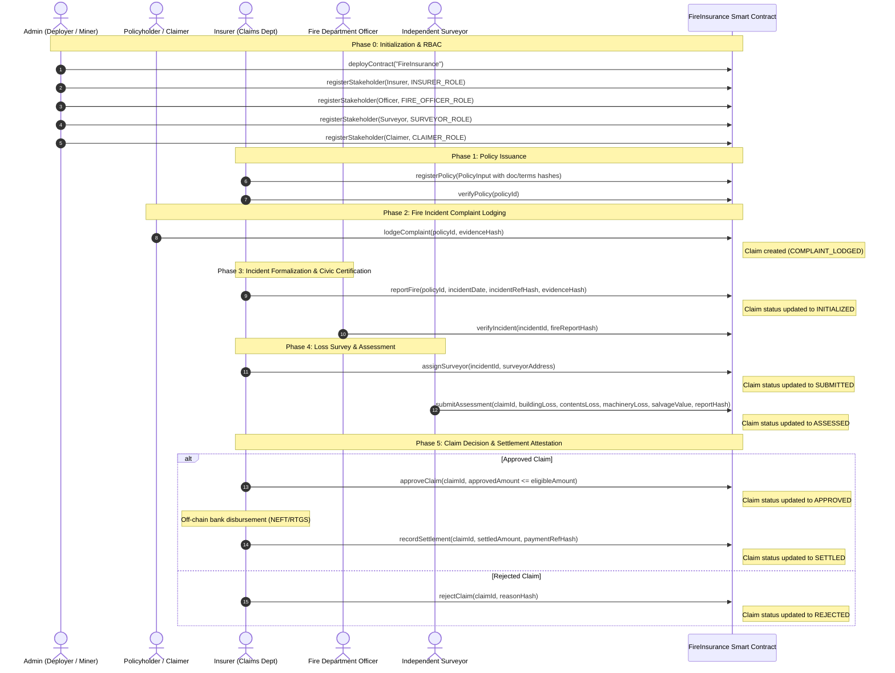
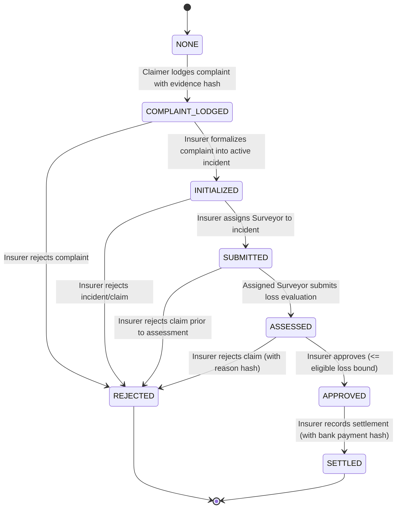

# FireChain — Decentralized Fire Insurance Claims Workflow Prototype

[](https://soliditylang.org/)
[](https://hardhat.org/)
[](https://openzeppelin.com/contracts/)
[](https://docs.ethers.org/v6/)
[](https://react.dev/)
[](https://vitejs.dev/)
[](https://tailwindcss.com/)
[](LICENSE)

**FireChain** is an enterprise-oriented smart contract prototype engineered on Ethereum. It provides a transparent, verifiable, and tamper-resistant workflow for fire insurance policy lifecycle management, citizen complaint lodging, civic fire incident verification, independent loss assessment, and claim settlements.

The architecture adopts an **off-chain document storage, on-chain cryptographic fingerprint ("Hash-on-Chain")** model. Sensitive original documents (policy contracts, evidence photos, fire department reports, and surveyor loss assessments) remain securely stored in local infrastructure, while immutable 32-byte SHA-256 / Keccak-256 hashes, timestamps, and multi-party attestations are recorded on the blockchain.

The project features both a **full CLI automation script suite** and an **interactive Web UI / DApp dashboard** powered by real MetaMask Web3 authentication and strict on-chain role enforcement.

---

## Table of Contents

- [Quick Start: Full Stack in 3 Commands](#quick-start-full-stack-in-3-commands)
- [Key Architecture & Design Principles](#key-architecture--design-principles)
- [Workflow & State Machine Diagrams](#workflow--state-machine-diagrams)
  - [Multi-Party End-to-End Sequence Diagram](#multi-party-end-to-end-sequence-diagram)
  - [Claim Lifecycle State Machine (8 States)](#claim-lifecycle-state-machine-8-states)
- [Stakeholders & 5 On-Chain Roles](#stakeholders--5-on-chain-roles)
- [Interactive Web UI / DApp Dashboard](#interactive-web-ui--dapp-dashboard)
- [Mathematical Loss & Claim Calculation](#mathematical-loss--claim-calculation)
- [Repository Directory Structure](#repository-directory-structure)
- [Prerequisites & Environment Setup](#prerequisites--environment-setup)
- [Step-by-Step CLI Execution Guide](#step-by-step-cli-execution-guide)
  - [1. Environment & Build Checks](#1-environment--build-checks)
  - [2. Start Local Node & Deploy](#2-start-local-node--deploy)
  - [3. End-to-End Claims Workflow](#3-end-to-end-claims-workflow)
  - [4. Query & Verification Commands](#4-query--verification-commands)
  - [5. Alternative Paths (Rejection & Cancellation)](#5-alternative-paths-rejection--cancellation)
  - [6. Local Document Hashing Utility](#6-local-document-hashing-utility)
- [Sepolia Testnet Deployment](#sepolia-testnet-deployment)
- [Security, Privacy & Prototype Limitations](#security-privacy--prototype-limitations)

---

## Quick Start: Full Stack in 3 Commands

To run the local blockchain and the interactive Web DApp dashboard simultaneously:

#### Terminal 1 — Start Local Ethereum Node:
```powershell
npx hardhat node --network hardhatMainnet
```

#### Terminal 2 — Deploy Contract & Seed Stakeholders:
```powershell
npm run deploy:local
npm run register:stakeholders
```

#### Terminal 3 — Launch the Frontend DApp:
```powershell
npm run frontend:dev
```
Open **`http://localhost:5173`** in your browser to access the FireChain dashboard.

---

## Key Architecture & Design Principles

1. **Hash-on-Chain Privacy**: Public blockchains are transparent. To protect policyholders and prevent GDPR/privacy violations, no personally identifiable information (PII), names, phone numbers, or confidential documents are written to the contract. Only cryptographic hashes (`bytes32`) serve as tamper-evident proofs.
2. **Citizen Complaint Lodging**: Claimants holding `CLAIMER_ROLE` initiate claims directly on-chain by lodging a preliminary complaint (`lodgeComplaint`) with photographic damage evidence hashes before insurers formalize incidents.
3. **Real-World Oracles & Separation of Duties**: Real-world authorized actors (Civic Fire Officers and Independent Surveyors) act as attestors / oracles to independently authenticate incidents and quantify physical loss before any claim approval.
4. **Strict Integer Loss Bounds**: Integer arithmetic denominated in **INR paise** (₹1 = 100 paise) prevents floating-point inaccuracies. Total loss and salvage guardrails (`salvageValue <= totalLoss`) are strictly verified on-chain.
5. **No Direct Token/Fiat Custody**: Settlements are recorded as insurer attestations linked to off-chain bank payment transaction hashes (NEFT / RTGS / UTR). The contract does not transfer ETH or fiat.
6. **Real Web3 Authentication**: No simulated Web2 credentials or fake personas. Users authenticate directly via MetaMask, and dashboard access is strictly governed by the on-chain `hasRole()` smart contract response.

---

## Workflow & State Machine Diagrams

### Multi-Party End-to-End Sequence Diagram



### Claim Lifecycle State Machine (8 States)



---

## Stakeholders & 5 On-Chain Roles

FireChain defines 5 distinct on-chain roles governed by OpenZeppelin's `AccessControl`:

| Role Constant | Hash Identifier (`keccak256`) | Responsibilities & Access Permissions |
| :--- | :--- | :--- |
| **`DEFAULT_ADMIN_ROLE`** | `0x0000...0000` | Deploys contracts, registers/revokes stakeholder roles (`registerStakeholder`), audits system ledgers. |
| **`INSURER_ROLE`** | `keccak256("INSURER_ROLE")` | Underwrites policies, verifies policy coverage, formalizes citizen complaints (`reportFire`), assigns surveyors, approves/rejects claims, records bank settlements. |
| **`FIRE_OFFICER_ROLE`** | `keccak256("FIRE_OFFICER_ROLE")` | Civic authority / oracle. Inspects incident reports, validates emergency dispatches, and commits official fire department report hashes on-chain (`verifyIncident`). |
| **`SURVEYOR_ROLE`** | `keccak256("SURVEYOR_ROLE")` | Licensed loss assessor. Submits itemized loss breakdowns (building, contents, machinery, salvage) and assessment report hashes (`submitAssessment`). |
| **`CLAIMER_ROLE`** | `keccak256("CLAIMER_ROLE")` | Policyholder / claimant. Lodges preliminary fire incident complaints with cryptographic damage evidence (`lodgeComplaint`) and tracks claim status. |

---

## Interactive Web UI / DApp Dashboard

The project includes an interactive Web3 dashboard located in [`frontend/`](frontend) designed for stakeholder interaction:

### Key Features
1. **Strict Web3 Authentication & 5-Role Protected Routing**:
   - Direct connection via MetaMask (`window.ethereum.request({ method: 'eth_requestAccounts' })`).
   - Auto-reloads and reconciles on `accountsChanged` and `chainChanged`.
   - Queries `hasRole()` on-chain for all 5 roles (`DEFAULT_ADMIN_ROLE`, `INSURER_ROLE`, `FIRE_OFFICER_ROLE`, `SURVEYOR_ROLE`, `CLAIMER_ROLE`).
   - Strict "Unauthorized Access" screen for unassigned wallets (`userRole === 'NONE'`); manual persona-switching is completely removed.
2. **Simplified Claimer Complaint Flow (`ClaimerDashboard`)**:
   - Streamlined policyholder experience: single numeric input for `policyId` (no complex manual hashing or file uploads required).
   - Directly executes `contract.lodgeComplaint(policyId)` on-chain.
   - Live read-only status tracking for the claimant's own complaints and settlements (`COMPLAINT_LODGED` -> `INITIALIZED` -> `SUBMITTED` -> `ASSESSED` -> `APPROVED` -> `SETTLED`).
3. **Civic Fire Oracle & Offline Auto-Hashing (`FireOfficerDashboard`)**:
   - Official Fire Department incident certification via `verifyIncident(incidentId, fireReportHash)`.
   - **Offline `crypto.subtle` Auto-Hashing**: Drag-and-drop file uploader that reads official incident reports into an in-memory `ArrayBuffer` and computes a 32-byte SHA-256 digest in real time. The raw file stays strictly on the client machine and is never transmitted over any network or blockchain.
4. **Surveyor Loss Quantification with Math Guardrails (`SurveyorDashboard`)**:
   - Itemized loss appraisal by category (Building, Contents, Machinery, Salvage) calling `submitAssessment(...)`.
   - **Client-Side Mathematical Guardrail**: Real-time evaluation prevents submission if $\text{salvageValue} > (\text{buildingLoss} + \text{contentsLoss} + \text{machineryLoss})$, displaying an alert and disabling the submit button to preempt on-chain revert.
   - Integrated offline `crypto.subtle` auto-hashing for the formal technical survey report.
5. **Insurer Full-Cycle Workflow Desk (`InsurerDashboard`)**:
   - 5 dedicated workflow stages: Policy Registration (`registerPolicy`), Policy Verification (`verifyPolicy`), Incident Formalization (`reportFire`), Surveyor Assignment (`assignSurveyor`), Claim Approval (`approveClaim`), and Bank Fiat Settlement Proof (`recordSettlement`).
6. **Admin Governance & RBAC Portal (`AdminDashboard`)**:
   - Live contract global metrics queried directly from storage (`getTotalPolicies`, `getTotalIncidents`, `getTotalClaims`, `getTotalAssessments`).
   - Stakeholder registration form: assigns `INSURER`, `FIRE_OFFICER`, `SURVEYOR`, or `CLAIMER` roles on-chain via `registerStakeholder(address, roleEnum)`.
   - On-chain role revocation support (`revokeStakeholder`).
7. **Live TransactionReceipt Block Visualizer**:
   - Reusable `<TransactionReceipt/>` component rendered upon every state-modifying transaction mined across all dashboards.
   - Visually presents `transactionHash`, mined `blockNumber`, and `gasUsed`, proving cryptographic finality and EVM block execution for academic presentations.

### Running the Frontend
```powershell
# From project root:
npm run frontend:dev

# Or inside frontend/:
cd frontend
npm run dev
```

Build for production:
```powershell
npm run frontend:build
```

---

## Mathematical Loss & Claim Calculation

When the surveyor submits an assessment, the smart contract enforces strict math guardrails before writing to storage:

$$\text{totalLoss} = \text{buildingLoss} + \text{contentsLoss} + \text{machineryLoss}$$

$$\text{grossLoss} = \text{totalLoss} - \text{salvageValue} \quad (\text{Contract enforces: } \text{salvageValue} \le \text{totalLoss})$$

$$\text{eligibleAmount} = \min\Big(\max(\text{grossLoss} - \text{deductible}, 0), \; \text{sumInsured}\Big)$$

- **Strict Salvage Guard**: `require(salvageValue <= totalLoss, "Salvage exceeds total loss");` prevents underflow.
- **Approval Guardrail**: The insurer can only approve an amount satisfying $0 < \text{approvedAmount} \le \text{eligibleAmount}$.
- **Settlement Guardrail**: The recorded settlement amount must strictly equal $\text{approvedAmount}$.

---

## Repository Directory Structure

```text
FireChain/
├── contracts/
│   └── FireInsurance.sol          # Core Solidity smart contract
├── frontend/                      # Web UI / DApp Dashboard
│   ├── index.html                 # Single page application entry
│   ├── package.json               # Frontend dependencies (React, Vite, Ethers, Tailwind)
│   ├── vite.config.ts             # Vite bundler configuration
│   ├── tailwind.config.js         # Custom theme & styling configuration
│   └── src/
│       ├── App.tsx                # Protected routing & Web3 authentication shell
│       ├── main.tsx               # React root render
│       ├── config/                # Contract ABI & network definitions
│       ├── context/               # Web3Context with MetaMask & on-chain role checks
│       ├── components/            # Navbar, StatCards, StatusBadges, FileHasher, TransactionReceipt
│       ├── pages/                 # Dashboard, Policies, Incidents, Claims, Roles, ClaimerPortal
│       └── utils/                 # Crypto hashing & currency formatters
├── scripts/
│   ├── deploy.ts                  # Hardhat deployment script
│   ├── register-stakeholders.ts   # Assigns RBAC stakeholder roles
│   ├── register-policy.ts         # Registers insurance policy
│   ├── verify-policy.ts           # Verifies policy underwriting
│   ├── report-fire.ts             # Reports fire incident
│   ├── verify-incident.ts         # Fire officer incident certification
│   ├── assign-surveyor.ts         # Assigns independent surveyor
│   ├── submit-assessment.ts       # Submits itemized loss assessment
│   ├── approve-claim.ts           # Insurer claim approval
│   ├── record-settlement.ts       # Insurer bank disbursement attestation
│   ├── reject-claim.ts            # Claim rejection with reason hash
│   ├── cancel-policy.ts           # Policy cancellation
│   ├── get-policy.ts              # Queries single policy record
│   ├── get-incident.ts            # Queries single incident record
│   ├── get-claim.ts               # Queries single claim record
│   ├── list-record.ts             # Comprehensive ledger audit summary
│   ├── test-roles.ts              # RBAC boundary verification
│   └── hash-document.ts           # CLI document SHA-256 calculator
├── test/
│   └── FireInsurance.test.ts      # Automated unit & integration tests (38 tests)
├── hardhat.config.ts              # Hardhat configuration (local & Sepolia)
├── package.json                   # Root dependencies & CLI npm scripts
└── README.md                      # Complete project documentation
```

---

## Prerequisites & Environment Setup

### System Requirements
- **Node.js**: v20 or higher
- **npm**: v10.0.0 or higher
- **OS**: Windows, macOS, or Linux

### Installation

Clone the repository and install all root and frontend dependencies:

```powershell
npm install
cd frontend && npm install && cd ..
```

Configure your local environment:
```powershell
cp .env.example .env
```

---

## Step-by-Step CLI Execution Guide

### 1. Environment & Build Checks

Compile the Solidity smart contracts:
```powershell
npm run compile
```

Run the automated test suite (38 passing tests):
```powershell
npm test
```

### 2. Start Local Node & Deploy

```powershell
# Terminal 1: Start node
npx hardhat node --network hardhatMainnet

# Terminal 2: Deploy & Seed Stakeholders
npm run deploy:local
npm run register:stakeholders
```

### 3. End-to-End Claims Workflow

1. **Register Insurance Policy**: `npm run register:policy`
2. **Verify Policy**: `npm run verify:policy`
3. **Report Fire Incident**: `npm run report:fire`
4. **Fire Department Verification**: `npm run verify:incident`
5. **Assign Independent Surveyor**: `npm run assign:surveyor`
6. **Submit Loss Assessment**: `npm run submit:assessment`
7. **Approve Claim**: `npm run approve:claim`
8. **Disburse & Record Bank Settlement**: `npm run record:settlement`
9. **Audit Ledger Summary**: `npm run list:records`

---

## Security, Privacy & Prototype Limitations

1. **Academic Scope**: This repository is an academic and architectural prototype. It has not undergone formal security audits and must not be used with real financial assets.
2. **Data Minimization**: Public blockchains cannot be made private through Solidity `private` variables. Sensitive data must never be committed to blockchain storage.
3. **Off-Chain Oracles**: Smart contracts cannot independently verify physical world events. The security model relies on the identity verification and integrity of designated fire department officials and licensed loss adjusters.
4. **Off-Chain Fiat Settlement**: Real-world claim disbursements occur through banking networks (NEFT/RTGS). The smart contract serves as an immutable audit trail and attestation log rather than a payment processor.

---

## License

This project is licensed under the **MIT License** — see the [LICENSE](LICENSE) file for details.
