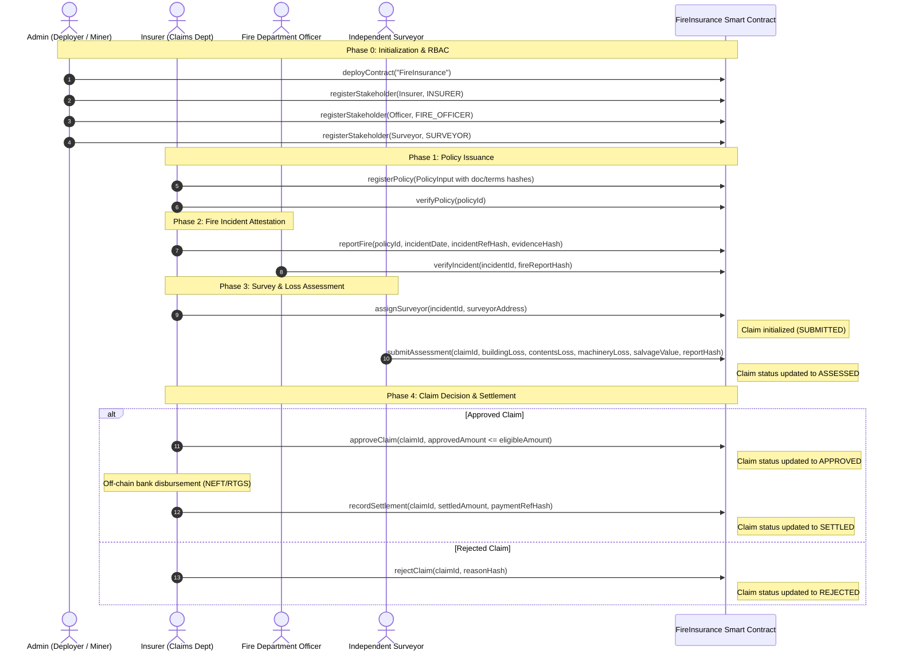

<<<<<<< HEAD
# FireChain — Decentralized Fire Insurance Claims Workflow Prototype

[](https://soliditylang.org/)
[](https://hardhat.org/)
[](https://openzeppelin.com/contracts/)
[](https://docs.ethers.org/v6/)
[](https://react.dev/)
[](https://vitejs.dev/)
[](https://tailwindcss.com/)
[](LICENSE)

**FireChain** is an enterprise-oriented, academic smart contract prototype engineered on Ethereum. It provides a transparent, verifiable, and tamper-resistant workflow for fire insurance policy lifecycle management, incident verification, loss assessment, and claim settlements.

The architecture adopts an **off-chain document storage, on-chain cryptographic fingerprint ("Hash-on-Chain")** model. Sensitive original documents (policy contracts, evidence photos, fire department reports, and surveyor loss assessments) remain securely stored in the insurer's local infrastructure, while immutable 32-byte SHA-256 / Keccak-256 hashes, timestamps, and multi-party attestations are recorded on the blockchain.

The project features both a **full CLI automation script suite** and an **interactive Web UI / DApp dashboard** with role-based portals for Insurers, Civic Fire Officers, Surveyors, and Admins.

---

## Table of Contents

- [Quick Start: Full Stack in 3 Commands](#quick-start-full-stack-in-3-commands)
- [Key Architecture & Design Principles](#key-architecture--design-principles)
- [Workflow & State Machine Diagrams](#workflow--state-machine-diagrams)
  - [Multi-Party End-to-End Sequence Diagram](#multi-party-end-to-end-sequence-diagram)
  - [Claim Lifecycle State Machine](#claim-lifecycle-state-machine)
- [Stakeholders, Roles & Pre-configured Accounts](#stakeholders-roles--pre-configured-accounts)
- [Interactive Web UI / DApp Dashboard](#interactive-web-ui--dapp-dashboard)
- [Mathematical Loss & Claim Calculation](#mathematical-loss--claim-calculation)
- [Repository Directory Structure](#repository-directory-structure)
- [Prerequisites & Environment Setup](#prerequisites--environment-setup)
- [Step-by-Step CLI Execution Guide](#step-by-step-cli-execution-guide)
  - [1. Environment & Build Checks](#1-environment--build-checks)
  - [2. Start Local Node & Deploy](#2-start-local-node--deploy)
  - [3. End-to-End 9-Step Claims Workflow](#3-end-to-end-9-step-claims-workflow)
  - [4. Query & Verification Commands](#4-query--verification-commands)
  - [5. Alternative Paths (Rejection & Cancellation)](#5-alternative-paths-rejection--cancellation)
  - [6. Local Document Hashing Utility](#6-local-document-hashing-utility)
- [Sepolia Testnet Deployment](#sepolia-testnet-deployment)
- [Security, Privacy & Prototype Limitations](#security-privacy--prototype-limitations)

---

## Quick Start: Full Stack in 3 Commands

To run the local blockchain and the interactive Web DApp dashboard simultaneously:

#### Terminal 1 — Start Local Ethereum Node:
```powershell
npx hardhat node --network hardhatMainnet
```

#### Terminal 2 — Deploy Contract & Seed Stakeholders:
```powershell
npm run deploy:local
npm run register:stakeholders
```

#### Terminal 3 — Launch the Frontend DApp:
```powershell
npm run frontend:dev
```
Open **`http://localhost:5173`** in your browser to access the FireChain dashboard.

---

## Key Architecture & Design Principles

1. **Hash-on-Chain Privacy**: Public blockchains are transparent. To protect policyholders and prevent GDPR/privacy violations, no personally identifiable information (PII), names, phone numbers, or confidential documents are written to the contract. Only cryptographic hashes (`bytes32`) serve as tamper-evident proofs.
2. **Real-World Oracles & Separation of Duties**: A blockchain cannot autonomously detect fires. Real-world authorized actors (Civic Fire Officers and Independent Surveyors) act as attestors / oracles to independently authenticate incidents and quantify physical loss before any claim approval.
3. **No Direct Token/Fiat Custody**: Amounts are denominated in integer **INR paise** (₹1 = 100 paise) to eliminate floating-point inaccuracies. Settlements are recorded as insurer attestations linked to off-chain bank payment transaction hashes (e.g., NEFT / RTGS / UTR). The contract does not transfer ETH or fiat.
4. **Historical Continuity on Cancellation**: If a policy is cancelled, `cancelledAt` is timestamped while `verified` remains true. Incidents occurring before cancellation remain historically eligible, while incidents on or after cancellation are rejected.

---

## Workflow & State Machine Diagrams

### Multi-Party End-to-End Sequence Diagram



### Claim Lifecycle State Machine

```mermaid
stateDiagram-v2
    [*] --> NONE
    NONE --> SUBMITTED : Insurer assigns Surveyor (Claim created)
    SUBMITTED --> ASSESSED : Assigned Surveyor submits loss evaluation
    SUBMITTED --> REJECTED : Insurer rejects claim prior to assessment
    ASSESSED --> APPROVED : Insurer approves (<= eligible loss)
    ASSESSED --> REJECTED : Insurer rejects claim (with reason hash)
    APPROVED --> SETTLED : Insurer records settlement (with bank payment hash)
    REJECTED --> [*]
    SETTLED --> [*]
=======
<div align="center">

# 🔥 PyroAegis
### Autonomous Parametric Fire Insurance & Blockchain Settlement Protocol

[](https://www.python.org/)
[](https://fastapi.tiangolo.com/)
[](https://react.dev/)
[](https://www.typescriptlang.org/)
[](https://soliditylang.org/)
[](https://hardhat.org/)
[](https://web3py.readthedocs.io/)
[](https://scikit-learn.org/)
[](https://tailwindcss.com/)
[](#running-automated-tests)
[](https://opensource.org/licenses/MIT)

<p align="center">
  <b>A zero-touch, fraud-resistant parametric insurance protocol that unifies real-time IoT hardware telemetry, dual-layer AI arbitration, and Ethereum smart contracts for instantaneous claim verification and indemnity disbursement.</b>
</p>

[Explore Features](#-key-features) •
[Architecture](#-system-architecture) •
[Quickstart Guide](#-quickstart-step-by-step-guide) •
[Frontend UI](#-interactive-frontend-dashboard) •
[API Reference](#-complete-api-reference) •
[Testing](#-running-automated-tests)

</div>

---

## 📖 Executive Summary

Traditional indemnity fire insurance is plagued by slow operational friction:
- **Lengthy Settlement Windows**: Policyholders frequently wait 30 to 90 days for on-site loss adjusters.
- **Subjective Claims Assessment**: Ambiguity in damage reports leads to disputed payouts and legal overhead.
- **Fraud & Tampering Vulnerability**: Manual paper claims are susceptible to post-incident fabrication.

**PyroAegis** replaces subjective claims processing with an **autonomous parametric protocol**:
1. **IoT Telemetry Ingestion**: Continuous monitoring of ambient temperature, optical smoke density, flame presence, and event duration.
2. **Dual-Layer Hybrid Arbitration**: Deterministic engineering thresholds validated against an ensemble **Random Forest Classifier** ($F_1\text{ Macro} = 98.50\%$) to reject sensor glitches, kitchen cooking smoke, and deliberate tampering.
3. **Decentralized On-Chain Oracle**: Confirmed incidents are cryptographically signed and stored in the **Ethereum `FireInsurance.sol` smart contract** using `keccak256` content hashing.
4. **Instant Parametric Liquidity**: Pre-underwritten policy triggers automatically disburse indemnities within seconds once on-chain event criteria are satisfied.

---

## ✨ Key Features

- 🛰️ **IoT Telemetry Pipeline**: Ingests multi-sensor arrays (thermocouples, optical smoke detectors, and infrared flame optical sensors) with temporal duration tracking.
- 🧠 **Anti-Tampering AI Engine**: Pre-trained Scikit-Learn pipeline using Polynomial feature interactions (`temp_smoke_interaction`, `is_high_risk`) to identify physical heating without actual combustion.
- ⛓️ **Hardhat EVM Integration**: Deploys native Solidity contracts (`0.8.24`) on local or testnet nodes, extracting cryptographic event logs (`EventRegistered`) via Web3.py.
- ⚡ **Zero-Touch Parametric Claims**: Algorithmic policy matching comparing sensor telemetry directly against policy limits for immediate payout authorization.
- 🖥️ **Professional Cyber-Slate Web Dashboard**: React 19 + TypeScript + Tailwind CSS UI featuring a live sensor simulation board, policy manager, claims execution hub, smart contract explorer, and AI explainability analytics.
- 🛡️ **Full Local Self-Sufficiency**: Runs 100% locally with Hardhat node, SQLite/SQLModel persistence, and embedded frontend delivery from a single FastAPI process.

---

## 🏗️ System Architecture

```mermaid
flowchart TD
    subgraph IoT ["1. IoT Sensor Telemetry Layer"]
        A1["Thermometer (°C)"]
        A2["Optical Smoke (ADC/PPM)"]
        A3["IR Flame Detector (Binary)"]
        A4["Duration Counter (Seconds)"]
        A1 & A2 & A3 & A4 -->|POST /api/fire/verify| B[FastAPI Gateway]
    end

    subgraph DecisionEngine ["2. Hybrid AI & Rule Arbitration Engine"]
        B --> C{Hybrid Verifier}
        C -->|Deterministic Rules| D["Rule Thresholds\n(Temp ≥ 60°C & Smoke ≥ 400 & Flame)"]
        C -->|Feature Engineering| E["Feature Pipeline\n(Outlier Clipping & Interaction Terms)"]
        E --> F["Random Forest Classifier\n(ai/model/best_model.pkl)"]
        D & F --> G["Arbitration Decision Matrix\n(CONFIRMED / POSSIBLE / NORMAL / MANUAL_REVIEW)"]
        G -->|Persist Incident| DB[("SQLite Database\nSQLModel ORM")]
    end

    subgraph Blockchain ["3. Decentralized Ethereum Blockchain Layer"]
        G -->|If Verified| H["Web3.py Client Service\n(Auto-sign with Private Key)"]
        H -->|registerEvent| I["FireInsurance.sol Contract\n(Hardhat EVM Node :8545)"]
        I -->|Emit| J["EventRegistered(bytes32 indexed eventId, bool approved)"]
        J -->|Receipt & Tx Hash| H
    end

    subgraph ParametricClaims ["4. Parametric Settlement Engine"]
        K["POST /api/claims"] --> L{"Policy Trigger Evaluator"}
        DB -->|Fetch FireEvent & Policy| L
        L -->|Conditions Satisfied| M["Status: APPROVED\nInstant Parametric Payout ($)"]
        L -->|Conditions Failed| N["Status: REJECTED / MANUAL_REVIEW"]
    end

    subgraph FrontendApp ["5. PyroAegis Web Application"]
        P["React 19 + TypeScript + Tailwind CSS Dashboard\n(http://127.0.0.1:8000)"]
        P <-->|REST API + Static SPA| B
    end
```

---

## 📁 Project Directory Structure

```
├── contracts/
│   └── FireInsurance.sol          # Solidity 0.8.24 Smart Contract (Parametric Policy & Event Ledger)
├── scripts/
│   └── deploy_fire_contract.js    # Hardhat ethers.js contract deployment script
├── backend/
│   ├── app.py                     # FastAPI entry point, CORS middleware & embedded SPA delivery
│   ├── config.py                  # Pydantic Settings reading .env configurations
│   ├── models/
│   │   ├── db.py                  # SQLite database engine & session dependency injection
│   │   ├── sensor_data.py         # Pydantic telemetry input schemas
│   │   └── tables.py              # SQLModel table definitions (FireEvent, Policy, Claim)
│   ├── routes/
│   │   ├── sensor_routes.py       # Raw IoT telemetry ingestion endpoints
│   │   ├── fire_routes.py         # Fire verification & blockchain registration routes
│   │   └── claim_routes.py        # Parametric policy and claim evaluation CRUD routes
│   ├── services/
│   │   ├── blockchain_service.py  # Web3.py client, transaction signing & receipt decoding
│   │   ├── fire_detection.py      # Deterministic rule-based threshold check
│   │   └── verification_service.py# Hybrid Rule + AI arbitration decision matrix
│   ├── storage/
│   │   └── database.db            # SQLite database file
│   └── tests/
│       ├── test_claims.py         # Pytest test suite for policies & claim evaluation
│       └── test_fire_verify.py    # Pytest test suite for sensor ingestion & blockchain verification
├── ai/
│   ├── inference/
│   │   └── ai_service.py          # Artifact loader & real-time inference scoring pipeline
│   ├── model/
│   │   ├── best_model.pkl         # Production Random Forest Classifier model
│   │   ├── preprocessing_pipeline.pkl # Scikit-Learn ColumnTransformer pipeline
│   │   └── model_metadata.json    # Model hyperparameters and evaluation metrics
│   ├── preprocessing/
│   │   └── pipeline.py            # Feature engineering, cleaning & scaling
│   ├── training/
│   │   ├── config.yaml            # Hyperparameter search space & CV configuration
│   │   └── train.py               # MLflow-tracked training & GridSearchCV optimization
│   └── tests/
│       └── test_ai_service.py     # Unit tests verifying edge-case classification
├── data/
│   └── raw/
│       └── fire_sensor_training_data.csv # 5,000+ labeled IoT sensor readings
├── frontend/                      # PyroAegis React Web Dashboard
│   ├── src/
│   │   ├── components/
│   │   │   ├── Navbar.tsx         # Responsive header with live EVM & AI health indicators
│   │   │   ├── DashboardView.tsx  # Executive overview, KPI stat cards & pipeline diagrams
│   │   │   ├── TelemetrySimulatorView.tsx # Interactive hardware sliders & 1-click test presets
│   │   │   ├── PoliciesView.tsx   # Parametric insurance policy registry & creation modal
│   │   │   ├── ClaimsView.tsx     # Pre-flight condition evaluator & claims ledger
│   │   │   ├── BlockchainLedgerView.tsx # On-chain event inspector & smart contract ABI viewer
│   │   │   └── AIModelView.tsx    # ML explainability, features & decision matrix
│   │   ├── services/
│   │   │   └── api.ts             # Fetch API client interfacing with backend routes
│   │   ├── types/
│   │   │   └── index.ts           # Comprehensive TypeScript interfaces
│   │   ├── App.tsx                # Main SPA routing & global state
│   │   └── index.css              # Custom Tailwind CSS styling & animations
│   ├── vite.config.ts             # Vite configuration with Tailwind plugin & backend proxy
│   └── package.json               # Frontend dependencies (React 19, Lucide, Tailwind)
├── hardhat.config.ts              # Hardhat configuration (Solidity 0.8.24 & local network)
├── package.json                   # Root package with Hardhat and frontend build scripts
├── requirements.txt               # Complete Python package dependencies
└── .env                           # Environment configuration
>>>>>>> 72c00741ff8a425676ac953906d996037488592b
```

---

<<<<<<< HEAD
## Stakeholders, Roles & Pre-configured Accounts

The prototype uses the standard Hardhat test mnemonic:
```text
test test test test test test test test test test test junk
```

When running local nodes (`npx hardhat node`), accounts are seeded with 10,000 local test ETH. Roles and permissions are strictly enforced on-chain via OpenZeppelin's `AccessControl`.

| Account Index | Stakeholder / Entity | Role Identifier | Public Address (Checksummed) | Private Key | Responsibilities & Permissions |
| :---: | :--- | :--- | :--- | :--- | :--- |
| **#0** | **Admin & Local Miner** | `DEFAULT_ADMIN_ROLE` | `0xf39Fd6e51aad88F6F4ce6aB8827279cffFb92266` | `0xac0974bec39a17e36ba4a6b4d238ff944bacb478cbed5efcae784d7bf4f2ff80` | Deploys contracts, registers/revokes stakeholder roles, mines blocks as default validator. |
| **#1** | **Insurer** | `INSURER_ROLE` | `0x70997970C51812dc3A010C7d01b50e0d17dc79C8` | `0x59c6995e998f97a5a0044966f0945389dc9e86dae88c7a8412f4603b6b78690d` | Underwrites policies, verifies coverage, reports fire incidents, assigns surveyors, approves/rejects claims, records bank settlements. |
| **#2** | **Fire Department Officer** | `FIRE_OFFICER_ROLE` | `0x3C44CdDdB6a900fa2b585dd299e03d12FA4293BC` | `0x5de4111afa1a4b94908f83103eb1f1706367c2e68ca870fc3fb9a804cdab365a` | Civic authority / oracle. Inspects incident reports, validates emergency dispatches, and commits official fire department report hashes on-chain. |
| **#3** | **Independent Surveyor** | `SURVEYOR_ROLE` | `0x90F79bf6EB2c4f870365E785982E1f101E93b906` | `0x7c852118294e51e653712a81e05800f419141751be58f605c371e15141b007a6` | Licensed loss assessor. Submits itemized loss breakdowns (building, contents, machinery, salvage) and assessment report hashes. |
| **#4** | **Unauthorized User / Claimant** | *None (Unprivileged)* | `0x15d34AAf54267DB7D7c367839AAf71A00a2C6A65` | `0x47e179ec197488593b187f80a00eb0da91f1b9d0b13f8733639f19c30a34926a` | Represents arbitrary external accounts or claimants. Used in negative testing to prove access restrictions. |

---

## Interactive Web UI / DApp Dashboard

The project includes an interactive Web3 dashboard located in [`frontend/`](frontend) designed for stakeholder demonstrations and evaluation:

### Key Features
1. **1-Click Dev Persona Switcher**:
   - Easily switch between **Admin**, **Insurer**, **Fire Officer**, and **Surveyor** directly from the top navigation dropdown.
   - Pre-configured with Hardhat local test wallets for instant evaluation without MetaMask or browser extensions.
   - Also supports **MetaMask / Injected Wallet** connections for Sepolia testnet testing.
2. **Offline Cryptographic Document Hasher**:
   - Drag-and-drop or upload any document (PDF, PNG, JPG).
   - Instant client-side SHA-256 fingerprint generation using native `crypto.subtle`. Documents are never transmitted over the network.
3. **Dedicated Portals**:
   - **Overview Dashboard**: High-level metrics (Policies, Incidents, Claims, Settled amount) and live claims feed.
   - **Policies Desk**: Policy underwriting registration, 1-click verification, historical cancellation, and real-time coverage lookup.
   - **Fire Incidents Desk**: Incident reporting with damage evidence fingerprints, and Civic Fire Officer certification queue.
   - **Claims & Surveying Desk**: Surveyor assignment, interactive itemized loss calculator with live eligible bound enforcement, insurer approval, and bank settlement attestation (UTR).
   - **Admin RBAC Console**: Role auditing and a **"1-Click Seed All Demo Roles"** utility.

### Running the Frontend
```powershell
# From project root:
npm run frontend:dev

# Or inside frontend/:
cd frontend
npm run dev
```

Build for production:
```powershell
npm run frontend:build
```

---

## Mathematical Loss & Claim Calculation

When the surveyor submits an assessment, the smart contract computes bounds using integer math:

$$\text{totalLoss} = \text{buildingLoss} + \text{contentsLoss} + \text{machineryLoss}$$

$$\text{grossLoss} = \text{totalLoss} - \text{salvageValue} \quad (\text{Contract enforces: } \text{salvageValue} \le \text{totalLoss})$$

$$\text{eligibleAmount} = \min\Big(\max(\text{grossLoss} - \text{deductible}, 0), \; \text{sumInsured}\Big)$$

- **Approval Guardrail**: The insurer can only approve an amount satisfying $0 < \text{approvedAmount} \le \text{eligibleAmount}$.
- **Settlement Guardrail**: The recorded settlement amount must strictly equal $\text{approvedAmount}$.

---

## Repository Directory Structure

```text
FireChain/
├── contracts/
│   └── FireInsurance.sol          # Core Solidity smart contract
├── frontend/                      # Web UI / DApp Dashboard
│   ├── index.html                 # Single page application entry
│   ├── package.json               # Frontend dependencies (React, Vite, Ethers, Tailwind)
│   ├── vite.config.ts             # Vite bundler configuration
│   ├── tailwind.config.js         # Custom theme & styling configuration
│   └── src/
│       ├── App.tsx                # App shell, tab switcher & alerts
│       ├── main.tsx               # React root render
│       ├── config/                # ABI definitions & Hardhat personas
│       ├── context/               # Web3Context provider & role detection
│       ├── components/            # Navbar, StatCards, StatusBadges, FileHasher
│       ├── pages/                 # Dashboard, Policies, Incidents, Claims, Roles
│       └── utils/                 # Crypto hashing & currency formatters
├── scripts/
│   ├── deploy.ts                  # Hardhat deployment script
│   ├── register-stakeholders.ts   # Assigns RBAC stakeholder roles
│   ├── register-policy.ts         # Registers insurance policy
│   ├── verify-policy.ts           # Verifies policy underwriting
│   ├── report-fire.ts             # Reports fire incident
│   ├── verify-incident.ts         # Fire officer incident certification
│   ├── assign-surveyor.ts         # Assigns independent surveyor
│   ├── submit-assessment.ts       # Submits itemized loss assessment
│   ├── approve-claim.ts           # Insurer claim approval
│   ├── record-settlement.ts       # Insurer bank disbursement attestation
│   ├── reject-claim.ts            # Claim rejection with reason hash
│   ├── cancel-policy.ts           # Policy cancellation
│   ├── get-policy.ts              # Queries single policy record
│   ├── get-incident.ts            # Queries single incident record
│   ├── get-claim.ts               # Queries single claim record
│   ├── list-record.ts             # Comprehensive ledger audit summary
│   ├── test-roles.ts              # RBAC boundary verification
│   └── hash-document.ts           # CLI document SHA-256 calculator
├── test/
│   └── FireInsurance.test.ts      # Automated unit & integration tests
├── hardhat.config.ts              # Hardhat configuration (local & Sepolia)
├── package.json                   # Root dependencies & CLI npm scripts
└── README.md                      # Complete project documentation
=======
## ⚙️ Hybrid AI & Arbitration Logic

To prevent both false alarms (e.g. harmless kitchen cooking smoke or elevated summer heat) and malicious fraud (e.g. holding a lighter directly against a thermometer), PyroAegis enforces a **dual-layer decision matrix**:

| Rule Engine Verdict | AI Classification | Final Verification Status | Settlement Action |
|:---|:---|:---|:---|
| `CONFIRMED_FIRE` | `CONFIRMED_FIRE` or `POSSIBLE_FIRE` | **`CONFIRMED_FIRE`** | ✅ Mined on Ethereum $\rightarrow$ Instant Claim Approval |
| `POSSIBLE_FIRE` | `CONFIRMED_FIRE` | **`CONFIRMED_FIRE`** | ✅ AI upgraded borderline case $\rightarrow$ Instant Claim Approval |
| `POSSIBLE_FIRE` | `POSSIBLE_FIRE` | **`POSSIBLE_FIRE`** | ⚠️ On-Chain Logged $\rightarrow$ Eligible for Automated Review |
| `NORMAL` | `NORMAL` | **`NORMAL`** | 🛑 Ambient conditions $\rightarrow$ No claim action |
| *Contradiction / Outlier* | *Disagreement* | **`MANUAL_REVIEW`** | 🔍 Sensor fault flagged $\rightarrow$ Claim routed for inspector review |

---

## 💻 Interactive Frontend Dashboard

The **PyroAegis** frontend provides a command center for insurance administrators, claims assessors, and smart contract auditors:

- **Executive KPI Dashboard**: Live tracker of active policies, verified fire incidents, total claims settled, approval rate %, and total disbursed indemnity.
- **Interactive IoT Telemetry Simulator**:
  - Live sliders for temperature ($-20^\circ\text{C}$ to $150^\circ\text{C}$), optical smoke density ($0$ to $1023\text{ PPM}$), and sustained exposure duration.
  - Optical IR flame toggle switch.
  - **1-Click Test Scenarios**: Safe Ambient Office, Kitchen Smoke, Overheated Radiator, Structural Blaze, and Sensor Glitch.
  - **Live Blockchain Proof**: Displays transaction hash (`tx_hash`) and smart contract event ID (`keccak256`) directly with copy-to-clipboard.
- **Parametric Underwriting Registry**: Create custom insurance policies with specific temperature/smoke thresholds and indemnity amounts, or use pre-configured industrial templates (*High-Risk Chemical Storage*, *Commercial Enterprise*, *Residential Condominium*).
- **Automated Claims Evaluation Hub**: 1-click condition evaluator verifying that the fire event was oracle-verified, temperature threshold was exceeded, smoke density was satisfied, and optical flames were detected.
- **Smart Contract & ABI Inspector**: Real-time explorer of on-chain mined events, gas fees, block numbers, and Solidity ABI functions (`registerEvent`, `getEvent`).
- **AI Diagnostics & Feature Explainability**: Detailed breakdown of Random Forest hyperparameters, $F_1$ score metrics, and engineered polynomial features.

---

## 📋 Prerequisites

Ensure your system meets the following prerequisites:
- **Node.js**: v18.0.0 or higher (`node -v`)
- **npm**: v9.0.0 or higher (`npm -v`)
- **Python**: v3.10 to v3.12 (`python --version`)
- **Git**

---

## 🚀 Quickstart: Step-by-Step Guide

Follow these steps to run the complete system locally.

### 1. Clone & Setup Workspace
```bash
git clone https://github.com/Priyankush123/Blockchain-Based-Automated-Fire-Insurance-Claim-System.git
cd Blockchain-Based-Automated-Fire-Insurance-Claim-System
```

### 2. Configure Python Virtual Environment
```bash
# Create Python virtual environment
python -m venv venv

# Activate Virtual Environment:
# On Windows (PowerShell):
.\venv\Scripts\Activate.ps1
# On Windows (CMD):
.\venv\Scripts\activate.bat
# On Linux/macOS:
source venv/bin/activate

# Install all backend, AI, and blockchain dependencies
pip install -r requirements.txt
```

### 3. Install Node & Frontend Dependencies
```bash
# Install root Hardhat & smart contract tools
npm install

# Install frontend React dependencies
npm run frontend:install

# Compile the production React build (embedded into FastAPI)
npm run frontend:build
```

### 4. Start the Local Ethereum Blockchain
In **Terminal 1**, start the local Hardhat EVM node:
```bash
npx hardhat node
```
*Keep this terminal open.* Hardhat launches a local JSON-RPC server at `http://127.0.0.1:8545` with 20 pre-funded test accounts (10,000 ETH each).

### 5. Deploy the Smart Contract
In **Terminal 2**, compile and deploy the `FireInsurance.sol` contract:
```bash
npx hardhat run scripts/deploy_fire_contract.js --network local
```
**Expected Output:**
```text
✅ FireInsurance deployed to: 0x5FbDB2315678afecb367f032d93F642f64180aa3
👉 Copy this address into your .env as FI_CONTRACT_ADDRESS
```

### 6. Verify Environment Configuration (`.env`)
Ensure your `.env` in the project root matches the deployed contract:
```env
# Blockchain settings
WEB3_RPC_URL=http://127.0.0.1:8545
FI_CONTRACT_ADDRESS=0x5FbDB2315678afecb367f032d93F642f64180aa3
FI_PRIVATE_KEY=0xac0974bec39a17e36ba4a6b4d238ff944bacb478cbed5efcae784d7bf4f2ff80

# AI model paths
MODEL_PATH=ai/model/best_model.pkl
PREPROCESSOR_PATH=ai/model/preprocessing_pipeline.pkl
METADATA_PATH=ai/model/model_metadata.json

# Verification thresholds
TEMPERATURE_THRESHOLD=60.0
SMOKE_THRESHOLD=400
REQUIRED_DURATION_SECONDS=5
```

### 7. Launch the Application (Backend + Frontend)
In **Terminal 2**, start the FastAPI server:
```bash
uvicorn backend.app:app --reload --host 127.0.0.1 --port 8000
```

🎉 **Access the Application**:
- 🌐 **PyroAegis Web Dashboard**: [http://127.0.0.1:8000/](http://127.0.0.1:8000/)
- 📑 **Interactive Swagger API Docs**: [http://127.0.0.1:8000/docs](http://127.0.0.1:8000/docs)
- 📑 **Redoc OpenAPI Specification**: [http://127.0.0.1:8000/redoc](http://127.0.0.1:8000/redoc)

### 8. (Optional) Run Frontend in Standalone Dev Mode
If you wish to modify the React frontend with instant Hot-Module-Reloading (HMR):
```bash
npm run frontend:dev
```
- Dev Server runs at: [http://127.0.0.1:5173/](http://127.0.0.1:5173/) (proxies API requests to port 8000).

---

## 🧪 Running Automated Tests

The repository includes a comprehensive, automated test suite covering unit, integration, and blockchain interaction layers.

```bash
# Run backend API, database, and smart contract integration tests
pytest backend/tests -v
```
*Expected: 15 passed in ~4.5 seconds.*

```bash
# Run AI model classification and edge-case unit tests
python -m unittest ai/tests/test_ai_service.py -v
```
*Expected: 6 passed in ~1.5 seconds.*

**Combined Test Results: 21 / 21 Tests Passing (100% Pass Rate).**

---

## 🔄 End-to-End Execution Walkthrough

You can test the entire lifecycle via the **Web UI** or via **CLI / cURL**:

### Option A: Via the Web Dashboard
1. Open [http://127.0.0.1:8000/](http://127.0.0.1:8000/).
2. Navigate to **Policies** and verify or create a policy (e.g. Temp $\ge 60^\circ\text{C}$, Smoke $\ge 400$, Payout $\$100,000$).
3. Navigate to **IoT Telemetry & Simulator**, select the **"Major Structural Blaze"** preset ($95^\circ\text{C}$, $880\text{ PPM}$, Flame Active), and click **"Transmit Telemetry & Verify Incident"**.
4. Observe the **CONFIRMED_FIRE** verdict and the newly mined Ethereum transaction hash and event ID.
5. Click **"Evaluate Claim for This Fire Event"**, confirm the 4 pre-flight checks, and click **"Execute Claim Evaluation"**.
6. View the instantaneous **APPROVED** status and $\$100,000$ payout in the settlement ledger!

---

### Option B: Via Command-Line / cURL

#### 1. Check System Health
```bash
curl -X GET http://127.0.0.1:8000/health
```
```json
{"status": "ok", "model_loaded": true}
```

#### 2. Create an Insurance Policy
```bash
curl -X POST http://127.0.0.1:8000/api/policies \
     -H "Content-Type: application/json" \
     -d '{
       "temperature_threshold": 60.0,
       "smoke_threshold": 400,
       "required_duration_seconds": 5,
       "payout_amount": 100000.0
     }'
```
*(Copy the generated policy `id`)*

#### 3. Ingest Fire Telemetry & Register On-Chain
```bash
curl -X POST http://127.0.0.1:8000/api/fire/verify \
     -H "Content-Type: application/json" \
     -d '{
       "device_id": "ESP32_WAREHOUSE_01",
       "property_id": "PROP_SECTOR_4",
       "temperature": 94.0,
       "smoke_level": 820,
       "flame_detected": true,
       "timestamp": "2026-09-30T10:00:00"
     }'
```
```json
{
  "verification": {
    "rule_verdict": "CONFIRMED_FIRE",
    "ai_result": { "fire_confidence": 1.0, "classification": "CONFIRMED_FIRE" },
    "verification_status": "CONFIRMED_FIRE",
    "reason": "Rule engine and AI both strongly indicate fire."
  },
  "verification_status": "CONFIRMED_FIRE",
  "fire_event_id": "4b684cb322744837a2e21297e6515d18",
  "blockchain": {
    "tx_hash": "0x70980c3475480854747e1e2b3bbe8abe63957b8ae4a7d9d1dbf3288b2270ad78",
    "event_id": "0x77fcb5a0f8f7701eae3b26a2d1c3e15f77c91656e202035ca5064810031306d1",
    "receipt": { "status": 1, "gasUsed": 164210 }
  }
}
```

#### 4. Evaluate & Settle the Claim
```bash
curl -X POST http://127.0.0.1:8000/api/claims \
     -H "Content-Type: application/json" \
     -d '{
       "event_id": "<fire_event_id>",
       "policy_id": "<policy_id>"
     }'
```
```json
{
  "id": "787fe155a0244485a37e5d8ff867bebc",
  "event_id": "4b684cb322744837a2e21297e6515d18",
  "policy_id": "67dae08f8bb14c778434a905a9686036",
  "status": "approved",
  "payout_amount": 100000.0,
  "created_at": "2026-09-30T10:05:00",
  "updated_at": "2026-09-30T10:05:00"
}
>>>>>>> 72c00741ff8a425676ac953906d996037488592b
```

---

<<<<<<< HEAD
## Prerequisites & Environment Setup

### System Requirements
- **Node.js**: v22.13.0 or higher
- **npm**: v10.0.0 or higher
- **OS**: Windows, macOS, or Linux

### Installation

Clone the repository and install all root and frontend dependencies:

```powershell
npm install
cd frontend && npm install && cd ..
```

Configure your local environment:
```powershell
cp .env.example .env
=======
## 📡 Complete API Reference

| HTTP Method | Endpoint Path | Description | Request Body | Response Codes |
|:---|:---|:---|:---|:---|
| `GET` | `/health` | Verify system health & model status | None | `200` |
| `GET` | `/api/model/info` | Fetch ML metadata & hyperparameters | None | `200`, `500` |
| `POST` | `/api/sensors/data` | Ingest raw sensor reading | `SensorData` JSON | `201`, `422` |
| `POST` | `/api/fire/verify` | Hybrid verification + Blockchain register | `SensorData` JSON | `200`, `500` |
| `GET` | `/api/fire/events` | List all historical fire incidents | None | `200` |
| `GET` | `/api/fire/events/{id}` | Get specific fire incident details | None | `200`, `404` |
| `POST` | `/api/policies` | Create a new parametric policy | `PolicyCreate` JSON | `201`, `422` |
| `GET` | `/api/policies` | List all active policies | None | `200` |
| `GET` | `/api/policies/{id}` | Get specific policy terms | None | `200`, `404` |
| `DELETE`| `/api/policies/{id}` | Remove a policy contract | None | `204`, `404` |
| `POST` | `/api/claims` | Evaluate event against policy for payout | `ClaimCreate` JSON | `201`, `404` |
| `GET` | `/api/claims` | List all evaluated claims | None | `200` |
| `GET` | `/api/claims/{id}` | Get claim status & payout receipt | None | `200`, `404` |

---

## 📜 Smart Contract Reference (`FireInsurance.sol`)

The `FireInsurance.sol` contract deployed on Ethereum / EVM:

```solidity
// SPDX-License-Identifier: MIT
pragma solidity ^0.8.24;

contract FireInsurance {
    struct Event {
        uint256 timestamp;
        string deviceId;
        string propertyId;
        int256 temperature;
        uint256 smokeLevel;
        bool flameDetected;
        bool verified;
    }

    mapping(bytes32 => Event) public events;
    event EventRegistered(bytes32 indexed eventId, bool approved);

    function registerEvent(
        string memory deviceId,
        string memory propertyId,
        int256 temperature,
        uint256 smokeLevel,
        bool flameDetected,
        bool verified
    ) external returns (bytes32) {
        uint256 ts = block.timestamp;
        bytes32 id = keccak256(abi.encodePacked(deviceId, ts));
        events[id] = Event({
            timestamp: ts,
            deviceId: deviceId,
            propertyId: propertyId,
            temperature: temperature,
            smokeLevel: smokeLevel,
            flameDetected: flameDetected,
            verified: verified
        });
        emit EventRegistered(id, verified);
        return id;
    }

    function getEvent(bytes32 id) external view returns (Event memory) {
        return events[id];
    }
}
>>>>>>> 72c00741ff8a425676ac953906d996037488592b
```

---

<<<<<<< HEAD
## Step-by-Step CLI Execution Guide

### 1. Environment & Build Checks

Check the installed Hardhat version:
```powershell
npx hardhat --version
```

Compile the Solidity smart contracts:
```powershell
npm run compile
```

Run the automated test suite on an in-memory network:
```powershell
npm test
```

---

### 2. Start Local Node & Deploy

#### Terminal 1: Launch Local Blockchain Node
Start a persistent local Hardhat Ethereum node (acts as local testnet and miner):
```powershell
npx hardhat node --network hardhatMainnet
```
*(Leave this terminal running. The node will display the 20 pre-funded test accounts, private keys, and live RPC transactions.)*

#### Terminal 2: Deploy Contract
Deploy the `FireInsurance` contract to the local node:
```powershell
npm run deploy:local
```

Upon successful deployment, update your `.env` file with the printed contract address:
```dotenv
FIRE_INSURANCE_ADDRESS=0x5FbDB2315678afecb367f032d93F642f64180aa3
```

---

### 3. End-to-End 9-Step Claims Workflow

Follow the sequential 9-step claim lifecycle via CLI:

```text
 1. npm run register:stakeholders   --> Register stakeholder roles
 2. npm run register:policy         --> Register insurance policy
 3. npm run verify:policy           --> Verify policy
 4. npm run report:fire             --> Report fire incident
 5. npm run verify:incident         --> Fire officer verification
 6. npm run assign:surveyor         --> Assign surveyor
 7. npm run submit:assessment       --> Submit loss assessment
 8. npm run approve:claim           --> Approve claim
 9. npm run record:settlement       --> Record settlement
```

#### Step 1: Register Stakeholders
Assigns `INSURER_ROLE`, `FIRE_OFFICER_ROLE`, and `SURVEYOR_ROLE` to demo accounts using the Admin account:
```powershell
npm run register:stakeholders
```

#### Step 2: Register Policy
Insurer registers a fire insurance policy with sum insured, deductible, date range, and document hashes:
```powershell
npm run register:policy
```

#### Step 3: Verify Policy
Insurer marks the policy as verified after underwriting validation:
```powershell
npm run verify:policy
```

#### Step 4: Report Fire Incident
Insurer logs a fire incident that occurred during the active policy window:
```powershell
npm run report:fire
```

#### Step 5: Fire Officer Verification
The authorized civic Fire Officer validates the incident and commits the official fire report hash:
```powershell
npm run verify:incident
```

#### Step 6: Assign Surveyor
Insurer assigns an authorized surveyor to inspect damages (creates Claim in `SUBMITTED` state):
```powershell
npm run assign:surveyor
```

#### Step 7: Submit Loss Assessment
The assigned surveyor submits itemized losses (building, contents, machinery, salvage):
```powershell
npm run submit:assessment
```

#### Step 8: Approve Claim
Insurer reviews the surveyor's assessment and approves an amount within the calculated eligible loss:
```powershell
npm run approve:claim
```

#### Step 9: Record Settlement
After executing an off-chain bank transfer (NEFT/RTGS), the insurer records the settlement attestation:
```powershell
npm run record:settlement
```

---

### 4. Query & Verification Commands

Inspect live blockchain state at any point in the workflow:

#### Query Policy Details
Fetches policy coverage, validity timestamps, and document hashes:
```powershell
npm run get:policy
```

#### Query Incident Details
Fetches reported incident timestamp, verification status, and fire officer report hash:
```powershell
npm run get:incident
```

#### Query Claim Details
Fetches claim status, assigned surveyor, assessed amount, approval, and settlement records:
```powershell
npm run get:claim
```

#### Audit Summary & Full Record Listing
Prints a complete audit log of all registered policies, fire incidents, claims, and assessments on-chain:
```powershell
npm run list:records
```

#### Access Control & Role Security Test
Tests authorization boundaries to prove that unprivileged accounts cannot execute restricted actions:
```powershell
npm run test:roles
```

---

### 5. Alternative Paths (Rejection & Cancellation)

#### Reject a Claim
An insurer may reject a claim at `SUBMITTED` or `ASSESSED` state with a cryptographic reason hash:
```powershell
npm run reject:claim
```

#### Cancel a Policy
An insurer can cancel an active policy. Incidents prior to `cancelledAt` remain valid; future incidents are rejected:
```powershell
npm run cancel:policy
```

---

### 6. Local Document Hashing Utility

Generate a standard SHA-256 fingerprint from any local document (PDF, PNG, DOCX) to pass to contract methods:

```powershell
npx tsx scripts/hash-document.ts ".\company_documents\policies\POLICY_001.pdf"
```

The script prints the 0x-prefixed 32-byte hash:
```text
File: D:\FireChain_Project\FireChain\company_documents\policies\POLICY_001.pdf
SHA-256: 0xa591a6d40bf420404a011733cfb7b190d62c65bf0bcda32b57b277d9ad9f146e
```

---

## Sepolia Testnet Deployment

To deploy and test on the Ethereum Sepolia Testnet:

1. **Obtain Testnet ETH**: Acquire Sepolia test ETH from an official faucet.
2. **Configure Credentials**: Update `.env` with your provider RPC URL and testnet private key:
   ```dotenv
   SEPOLIA_RPC_URL=https://eth-sepolia.g.alchemy.com/v2/YOUR_API_KEY
   SEPOLIA_PRIVATE_KEY=0xYOUR_TESTNET_PRIVATE_KEY
   ```
   *(Ensure `.env` is never committed to source control.)*
3. **Deploy to Sepolia**:
   ```powershell
   npm run deploy:sepolia
   ```
4. Update `FIRE_INSURANCE_ADDRESS` in `.env` with the newly deployed Sepolia contract address.

---

## Security, Privacy & Prototype Limitations

1. **Academic Scope**: This repository is an academic and architectural prototype. It has not undergone formal security audits and must not be used with real financial assets.
2. **Data Minimization**: Public blockchains cannot be made private through Solidity `private` variables. Sensitive data must never be committed to blockchain storage.
3. **Off-Chain Oracles**: Smart contracts cannot independently verify physical world events. The security model relies on the identity verification and integrity of designated fire department officials and licensed loss adjusters.
4. **Off-Chain Fiat Settlement**: Real-world claim disbursements occur through banking networks (NEFT/RTGS). The smart contract serves as an immutable audit trail and attestation log rather than a payment processor.
=======
## 🛠️ Troubleshooting & FAQ

<details>
<summary><b>1. Port 8545 or 8000 already in use (EADDRINUSE / WinError 10048)</b></summary>

If a previous Hardhat node or Uvicorn process is still running:
- **Windows (PowerShell)**:
  ```powershell
  # Find PID using port 8545 or 8000
  Get-NetTCPConnection -LocalPort 8545 -ErrorAction SilentlyContinue | Select-Object -Property OwningProcess
  # Stop the process
  Stop-Process -Id <PID> -Force
  ```
- **Linux / macOS**:
  ```bash
  kill -9 $(lsof -t -i:8545)
  kill -9 $(lsof -t -i:8000)
  ```
</details>

<details>
<summary><b>2. Contract address mismatch ("Unable to connect" or "execution reverted")</b></summary>

Whenever you restart the Hardhat node (`npx hardhat node`), all blockchain state resets to block 0.
1. Re-deploy the contract: `npx hardhat run scripts/deploy_fire_contract.js --network local`.
2. Check the output address and ensure `FI_CONTRACT_ADDRESS` in `.env` matches the deployed address.
3. Restart the FastAPI server.
</details>

<details>
<summary><b>3. Why is Hardhat node required before running the backend?</b></summary>

The backend initializes a Web3.py client connected to `http://127.0.0.1:8545`. If the node is offline, FastAPI startup will raise a connection error. Always start `npx hardhat node` first.
</details>

---

## 📄 License

This project is licensed under the **MIT License** — see the [LICENSE](LICENSE) file for details.
>>>>>>> 72c00741ff8a425676ac953906d996037488592b
